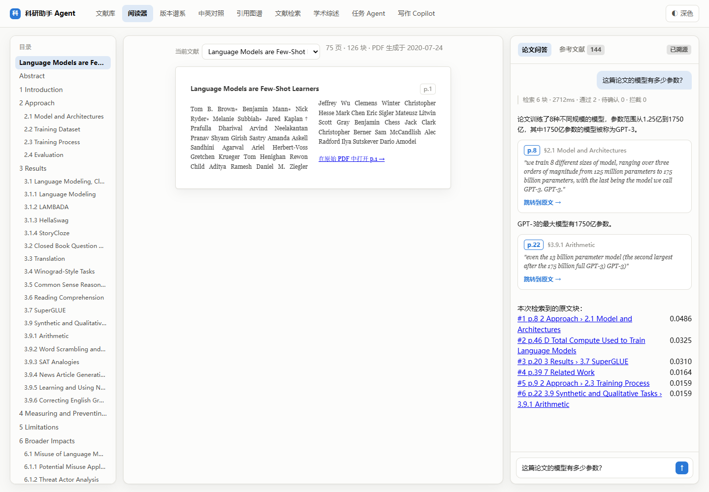
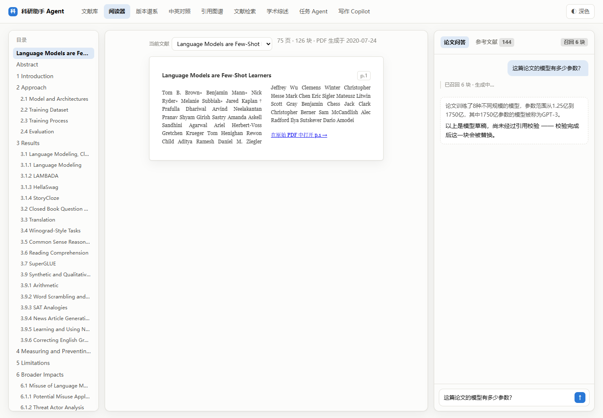
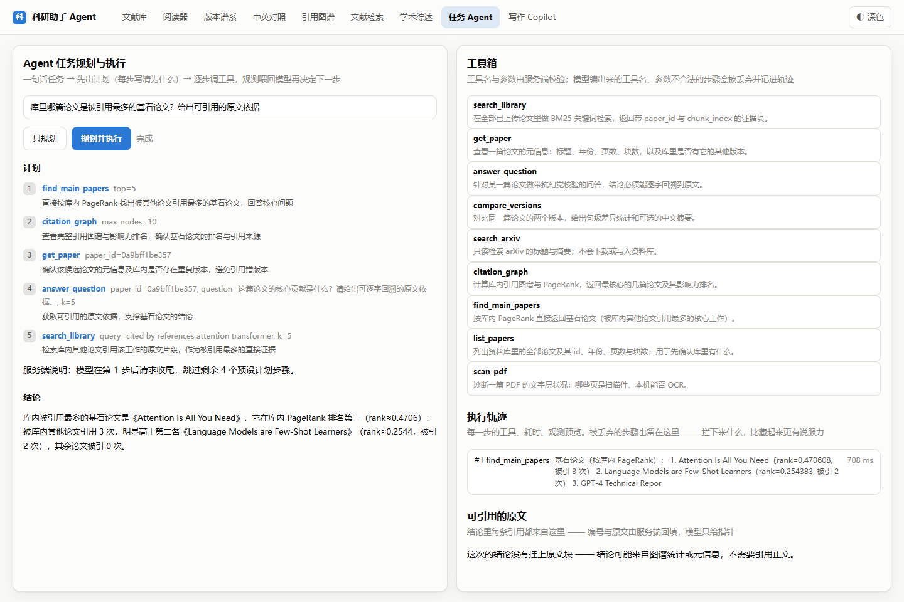
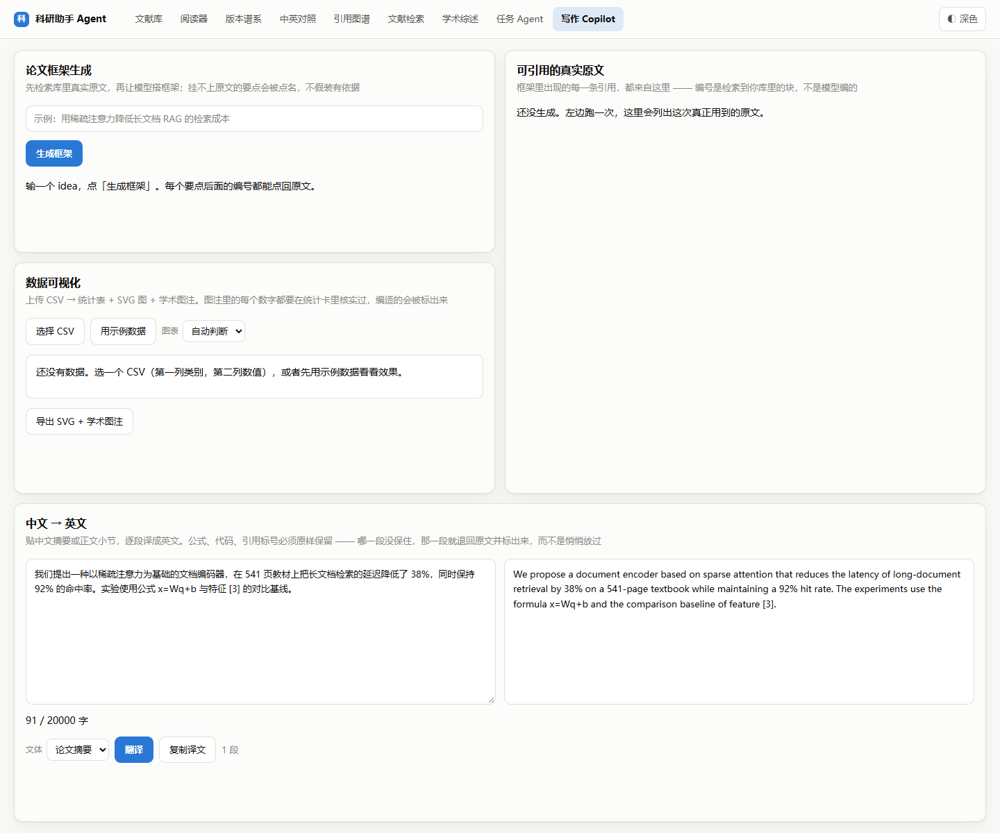

# 科研助手 Agent

> 每句话都能点回原文精确位置的版本感知科研 Agent

一句话 → 检索 → 生成 → **逐条核对回原文**：核对得上的结论带页码与坐标框返回，
核对不上的直接拦下并说明原因。不是"让模型答得好"，而是**让模型没法乱答**。

## 快速开始

```bash
cd apps/api
uv sync                                    # 装依赖（走清华镜像）
cp ../../.env.example ../../.env           # 填 DEEPSEEK_API_KEY
uv run uvicorn app.api.main:app --reload --port 8017
```

打开 <http://127.0.0.1:8017/> —— 前端由同一个服务托管，无需另起进程。

- `/docs`　自动生成的 OpenAPI 文档
- 仓库根放一份 PDF 后，在界面点「＋ 上传 PDF」即可解析入库
- 演示深链：`/?paper=<文献 id>&ask=<问题>` 直接打开某篇并提问

## 界面

全部截图由 CDP 驱动真实浏览器拍下（`scripts/shoot.py`），不是设计稿。

| 问答：每条结论都带页码与原文 | 流式：草稿区明写"尚未校验" |
|---|---|
|  |  |

| 上传冲突：说清哪一版更新，覆盖还是保留由人定 | Agent：计划、执行轨迹、可引用原文 |
|---|---|
|  |  |

| CSV → 图 + 数字核验过的图注 | 中译英：公式与引用标号原样保留 |
|---|---|
|  |  |

更多（深色主题、窄屏、引用图谱、版本对比）在同目录 `docs/screenshots/live/`。

## 目录

```
apps/api/app/
  parsing/     chunker.py      结构感知切块（段落不切开，标题必开新块，去页眉页脚）
               text_index.py   词级索引，给任意引用文本落回页码 + bbox
               scan.py         扫描件 OCR 钩子（有 Tesseract 才启用）
  retrieval/   bm25.py         词法检索 + 单复数归并 + RRF 融合
               embeddings.py   BGE 的 ONNX 推理（不引 torch）
               dense.py        向量检索（可选通道，见 E-004）
  rag/         query.py        检索词扩展 + 多路召回
               answer.py       证据 → 结论 → 校验 → 回填坐标
               streaming.py    流式问答的事件载荷与 JSON 草稿解析
               bilingual.py    逐段中英对照（段数守恒，对不上就降级）
               translate_zh.py 中译英：公式/代码/引用标号丢了就整段退回
               copilot.py      全库检索 → 编号证据 → 框架 + 真实引用
               review.py       综述生成 + Future Work（证据块先行，引用服务端回填）
  guardrails/  citation.py     三级匹配（逐字 / 截断容错 / 模糊），给出 supported/weak/unsupported
  agent/       planner.py      两阶段规划 + 动态重规划，9 个可调用工具
               registry.py     工具注册表（名称、参数、返回契约）
  analysis/    csv_table.py    CSV 列类型识别 + 统计卡
               chart.py        纯手写 SVG：柱状/折线/散点/雷达，配色烘焙进属性
               export.py       TikZ / Mermaid / Matplotlib 源码导出
  versioning.py               版本谱系：关系判定 + 句级对齐 + 噪声过滤
  versioning_summary.py       把差异翻成中文（模型挂了就如实降级）
  references.py               参考文献解析：数字标记 / 字母标记 / ACL 无标记三种版面
  citegraph.py                引用图谱：版本聚类 → 标题匹配 → 手写 PageRank → 确定性布局
  api/         main.py         上传 / 列表 / 删除 / 单篇读取等核心路由
               deps.py         路由共享件（注册表、序列化），避免与 main.py 循环引用
               registry.py     文档注册表（内容哈希去重，重启自动恢复）
               routers/        按功能拆分的 APIRouter：agent / dataviz / review /
                               stream / tools / translate
apps/web/      index.html     单文件前端，直连上面的接口
prototype/     mockup.html    设计稿（对照用，不接数据）
```

## 接口

| 方法 | 路径 | 说明 |
|---|---|---|
| GET | `/api/health` | 存活、文献数、是否配好大模型 |
| GET | `/api/papers` | 文献列表（重复论文会带 `duplicate_of` / `relation` / `recommendation`） |
| POST | `/api/papers` | 上传 PDF（multipart），按内容哈希去重；`on_duplicate=warn\|keep\|replace` |
| POST | `/api/papers/batch` | 批量上传（≤20 个），逐条返回成功/失败/跳过及原因 |
| DELETE | `/api/papers/{id}` | 从库里删掉一篇：内存、sidecar、落盘副本一起删，返回 204；文件被占用时 409 并保持状态一致 |
| GET | `/api/papers/{id}/chunks` | 块列表，含全文与 bbox |
| GET | `/api/papers/{id}/references` | 参考文献条目（三种版面） |
| GET | `/api/papers/{id}/file` | 原始 PDF（可 `#page=N` 直达某页） |
| GET | `/api/papers/{id}/scan` | 扫描件判定与 OCR 状态 |
| POST | `/api/papers/{id}/qa` | 问答，返回结论 + 锚点 + 守卫统计 |
| POST | `/api/papers/{id}/qa/stream` | 同一链路的 SSE 版本：`meta → queries → evidence → token* → claims → done`，失败只发 `error` 不发 `done` |
| GET | `/api/papers/{id}/bilingual?chunk=N` | 某个块的中英逐段对照；大模型不可用或段数不符时 `degraded=true`，原文照常返回 |
| GET | `/api/papers/{id}/compare/{other}` | 两版差异（谁新谁旧按 PDF 生成日期判）；`?summarize=false` 跳过中文归纳 |
| GET | `/api/graph` | 引用图谱：节点 + 边 + 库内 PageRank + 归一化坐标；`?max_external=N` 控制库外文献数（夹在 0–60） |
| POST | `/api/copilot/outline` | 论文框架：全库检索 → 编号证据 → 框架；引用由服务端回填，模型编的编号直接丢弃 |
| POST | `/api/review` | 综述 + Future Work：多查询扩展召回，参考文献表与目录页永不进证据 |
| GET | `/api/tools/arxiv/search` | arXiv 检索（断网时 `degraded=true`，不报 500） |
| POST | `/api/tools/arxiv/ingest` | 检索结果直接入库：下载 → 解析 → 去重 |
| GET | `/api/agent/tools` | 9 个工具的名称、参数与返回契约 |
| POST | `/api/agent/plan` | 只规划不执行：步骤 + 每步理由 |
| POST | `/api/agent/run` | 规划 → 执行 → 观察 → 重规划，返回完整轨迹与可引用原文 |
| POST | `/api/dataviz/chart` | CSV → 统计表 + SVG + TikZ/Mermaid/Matplotlib + 图注（数字逐个核验） |
| POST | `/api/dataviz/preview` | 只解析不画图：列类型、统计量、前 100 行 |
| POST | `/api/translate/zh-en` | 中文 → 英文逐段翻译；公式/代码/`[n]` 没保住的那段退回原文 |

问答的 `mode` 有两种：

- `answer`：走大模型，返回带锚点的结论（默认）
- `retrieve`：只返回召回的证据块，**不依赖大模型成功** —— 断网/欠费时仍能演示检索
  （会尽力做检索词扩展，失败就退回原始问题）

流式接口有一个必须说清的前提：`token` 发出去的是**未经校验**的模型原文
（这条链路答案是 JSON，所以屏幕上先滚出来的是半截 JSON）。抗幻觉校验在流结束后
才跑，结果通过 `claims` 覆盖展示，被拦下的条目带 `status=unsupported` 与原因。
"流式渲染"不等于"流式也经过校验"。

## 测试

```bash
cd apps/api && uv run pytest -q     # 305 项
```

覆盖：切块的边界条件、BM25 排序与单复数归并、RRF 去重、守卫的三级匹配、
Q&A 的"编造引用必须被丢弃"、HTTP 层的降级与去重、重启后资料库恢复、
版本谱系的降噪与"投稿戳不许混进正文"、对比接口的新旧顺序与大模型断供降级、
参考文献解析（三种版面 + 年份不许取自 arXiv 号）、PageRank 的方向与权威传递、
版本合并成单个节点、图谱坐标的确定性、中英对照的段数守恒与降级、
框架生成丢弃不存在的证据编号、删除接口的三处同步（内存、sidecar、落盘副本，
少删一处就会"删了又回来"），以及 **541 页教材**这条最难的路：
带页码的隔页页眉、页码引用、Bibliography、只能靠字号保住的一级标题。

这一轮新增的部分：

- **去重策略**：warn/keep/replace 三种策略、同文件重传是无操作（不删原件）、
  "哪一版更新"只看 PDF 生成日期且两版都取不到日期时拒绝猜、批量上传的部分成功、
  21 个文件在读之前就被拦下。
- **流式问答**：七种事件的顺序、`error` 绝不伴随 `done`、无召回时不发 token、
  模型逐 token 吐 JSON 时的解析、断连时不泄漏生成器。
- **综述**：0 召回时不再退回首页作者名单、多条检索式合并去重、单条检索式坏掉不影响整批、
  参考文献表永不进证据、Future Work 只从正文里找。
- **Agent**：工具的入参校验、`plan` 与 `run` 的计划一致性、执行失败后重规划、
  步骤上限、轨迹里每个工具调用的 `took_ms` 与观察摘要。
- **数据可视化**：列类型识别与统计卡、四类图的 SVG 结构、图注数字逐个核验
  （编造的替换成 `[未核实]`、大面积编造退回模板）、模型不可用返回 200 + `degraded`、
  导出源码与图共用同一份清洗后数据、错误码分级（400/413/422）。
- **中译英**：公式/代码/`[n]` 丢了就整段退回原文、段数守恒、超长输入 413、空输入 400。

## 实验记录

所有"哪个方案更好"的结论都带数字，写在 [`docs/EXPERIMENTS.md`](docs/EXPERIMENTS.md)，
包括**被数据推翻的假设**（检索式加权、密集检索融合）。没有数字的取舍不写进去。

## 配置

| 环境变量 | 说明 |
|---|---|
| `DEEPSEEK_API_KEY` | 必填，生成与检索词扩展 |
| `DEEPSEEK_BASE_URL` | 可选，默认 `https://api.deepseek.com` |
| `LLM_MODEL` | 可选，默认 `deepseek-chat` |
| `PAPER_STORE_DIR` | 可选，PDF 落盘目录，默认 `data/papers` |
| `ARXIV_TLS13` | 可选，设 `1` 才允许与 arXiv 协商 TLS 1.3。默认锁 TLS 1.2：实测 1.3 只有 16 KB/s，1.2 是 95 KB/s 以上（见 `docs/EXPERIMENTS.md` E-013） |

`.env` 已在 `.gitignore` 里，密钥不进仓库。

## 部署与运行（Docker）

> 说明：仓库提供了 `Dockerfile`、`.dockerignore`、`docker-compose.yml` 与 `.env.example`，
> 但提交时**没有在本机实际执行 `docker build`**（本机不联网、不拉镜像）。
> 以下命令按标准 Docker / Compose 行为编写，首次在评审环境构建时请以实际输出为准。

### 构建与启动（推荐 Compose）

```bash
cp .env.example .env          # 填入 DEEPSEEK_API_KEY；不要把 .env 提交或打进镜像
docker compose up --build -d
docker compose ps             # 等 health 变成 healthy
curl http://127.0.0.1:8017/api/health
```

打开 <http://127.0.0.1:8017/>，前端仍由同一个容器托管。

只用 Docker、不经 Compose：

```bash
docker build -t research-agent-api:local .
docker run --rm -p 8017:8017 \
  --env-file .env \
  -v "$PWD/data:/app/data" \
  research-agent-api:local
```

### 端口说明

应用代码本身不解析端口（`app/api/main.py` 只导出 `app` 对象），所以端口必须由启动命令传给 uvicorn：

- Dockerfile 的 `CMD` 是 `sh -c "exec uvicorn ... --port ${PORT:-8017}"`，默认 8017；
- Compose 里 `ports` 与 `environment.PORT` 都使用 `${PORT:-8017}`，两边一起变，避免映射错位；
- 直接在本机开发/手动启动时，仍然要显式写 `--port 8017`（与「快速开始」一致）。

只设置 `PORT=9000` 而不经过 Dockerfile 的 CMD 或 Compose，**不会**改变 uvicorn 的监听端口。

### 环境变量

| 变量 | 必填 | 默认值 | 用途 |
|---|---|---|---|
| `DEEPSEEK_API_KEY` | 是（否则模型接口降级） | 空 | 生成、检索词扩展、中译英 |
| `DEEPSEEK_BASE_URL` | 否 | `https://api.deepseek.com` | DeepSeek API 地址 |
| `LLM_MODEL` | 否 | `deepseek-chat` | 模型名 |
| `LLM_STREAM_TIMEOUT` | 否 | `60` | 流式响应两次 token 之间的最长等待（秒） |
| `PAPER_STORE_DIR` | 否 | 本地 `<仓库根>/data/papers`；容器内 `/app/data/papers` | PDF 与 sidecar 落盘目录 |
| `ARXIV_TLS13` | 否 | 空（锁 TLS 1.2） | 设 `1` 允许与 arXiv 协商 TLS 1.3；1.2 在本机快 6 倍 |
| `PORT` | 否 | `8017` | 仅 Docker 启动命令使用；应用代码不直接读取 |

`.env.example` 只含占位符。密钥通过 `env_file` / `--env-file` / `-e` 注入，**不要写进 Dockerfile、
不要提交到仓库、也不要 `COPY` 进镜像**。

### 数据卷

- Compose 挂载 `./data:/app/data`，上传的 PDF、sidecar 与解析缓存都在宿主机上，容器重建不丢。
- 镜像内声明了 `VOLUME ["/app/data"]`，即使不用 Compose 也不会把资料写进镜像层。
- Linux 宿主机上容器以 UID 10001 运行；如果 `./data` 属于别的用户，会写不进去，
  可执行 `sudo chown -R 10001:10001 ./data`，或改用命名卷。
- 向量检索是可选通道：默认走纯词法 BM25，不挂模型也能跑。需要 `--dense` / `--hybrid` 时，
  把本地 `models/` 只读挂到容器（Compose 文件里已留注释行）。

### 健康检查

- 镜像内 `HEALTHCHECK` 与 Compose `healthcheck` 都请求 `/api/health`，默认每 30 秒一次；
- 查看状态：`docker inspect --format '{{.State.Health.Status}}' <container>`；
- `/api/health` 返回 `ok`、文献数、`llm_configured`，可用来判断是服务没起来还是没配 key。

### 常见问题

- **基础镜像拉不动**：`python:3.11-slim` 来自 Docker Hub。可在 Docker Desktop 的
  Settings → Docker Engine 里配置 `registry-mirrors`（例如所在网络可用的国内加速地址），
  或先 `docker pull <可用镜像源>/library/python:3.11-slim` 再 `docker tag` 成 `python:3.11-slim`。
  注意 `registry-mirrors` 只作用于 Docker Hub，不会自动加速 ghcr.io 等其他 registry ——
  这也是 Dockerfile 选择 `pip install uv`、而不是从 ghcr.io 拷 uv 二进制的原因。
- **依赖下载失败或太慢**：构建时默认用清华源；可覆盖：
  `docker build --build-arg PYPI_INDEX_URL=https://<你的镜像>/simple -t research-agent-api:local .`。
  `uv.lock` 记录了清华源的下载地址；Dockerfile 检测到 `PYPI_INDEX_URL` 与锁文件不一致时，
  会自动改为重新解析依赖（默认清华源路径仍严格按锁文件安装，保持可复现）。
- **接口返回 `degraded=true` 或提示缺少 key**：先确认 `.env` 存在并被注入
  （`docker compose config` 可查看最终配置）。不要为了省事把 key 写进 Dockerfile 或镜像历史。
- **容器 healthy 但写 PDF 报权限错误**：见上面「数据卷」的 UID/权限说明。
- **端口被占用**：改 `.env` 里的 `PORT`，或直接 `PORT=8018 docker compose up -d`；
  Compose 的宿主机端口与容器端口会一起变。

### 镜像体积

多阶段构建，最终镜像只包含 `python:3.11-slim` 运行时 + `/app/.venv` + 源码与前端；
`models/`（约 128MB）、`pdf/`、`data/`、`.git`、`__pycache__`、`.env` 均由 `.dockerignore` 排除。
依赖里刻意没有 torch，主要体积来自 onnxruntime、numpy、pymupdf，预计未压缩约 250–350MB
（实际以 `docker images` 为准；本次未构建验证）。

