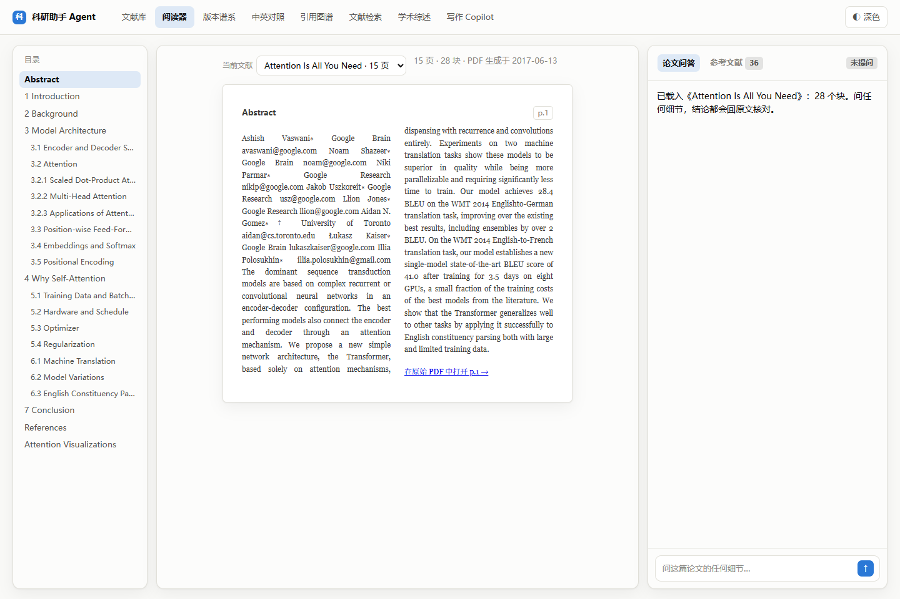
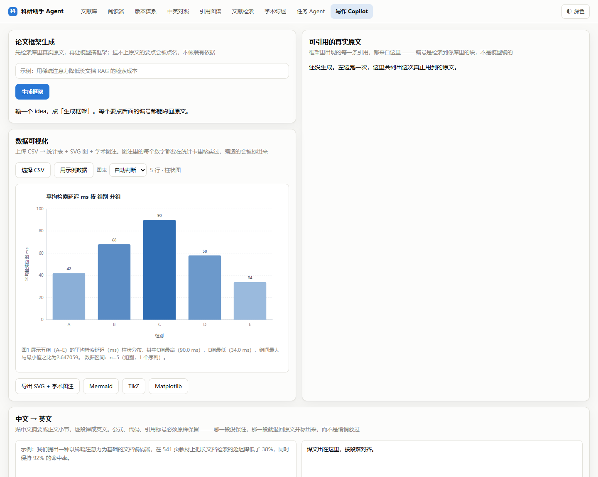
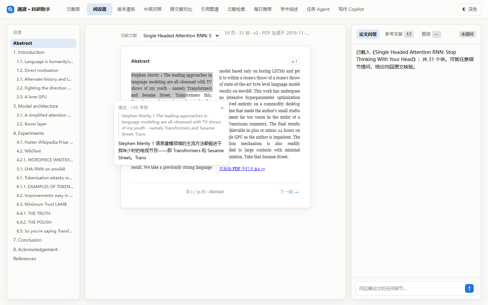
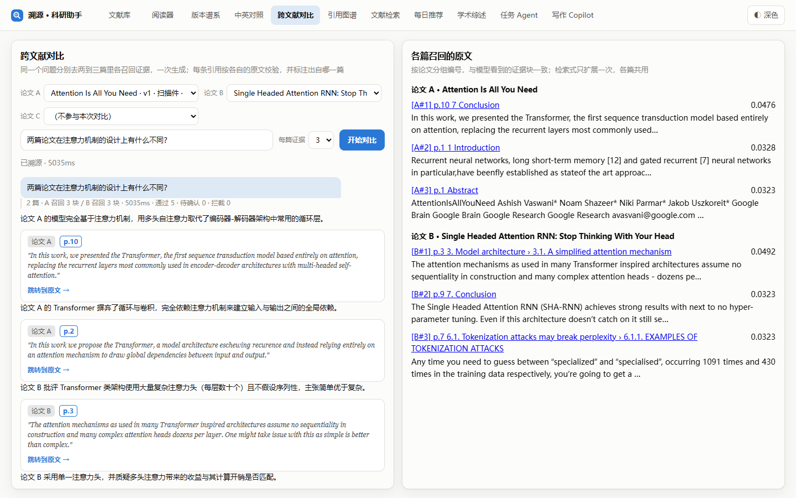
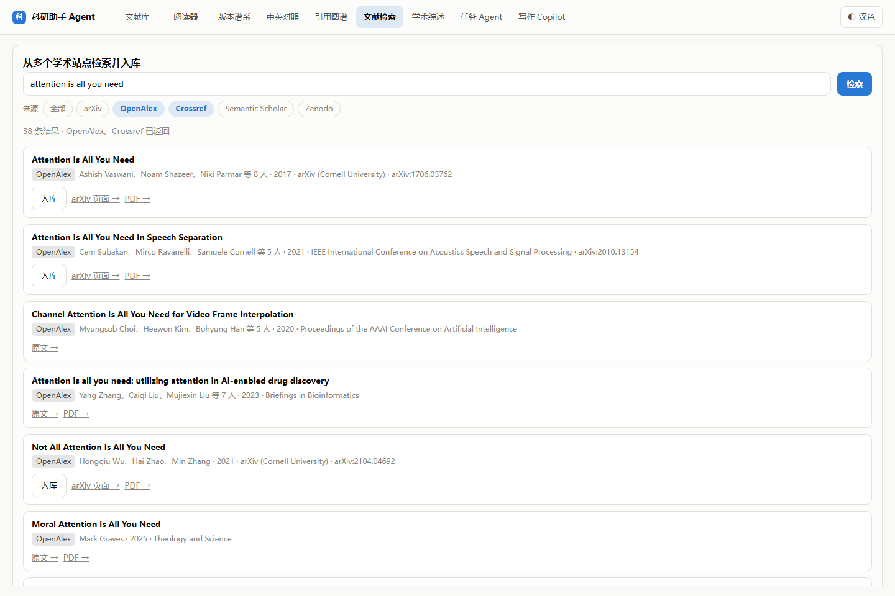

# 科研助手 Agent

> 每句话都能点回原文精确位置的版本感知科研 Agent

一句话 → 检索 → 生成 → **逐条核对回原文**：核对得上的结论带页码与坐标框返回，
核对不上的直接拦下并说明原因。不是"让模型答得好"，而是**让模型没法乱答**。

## 快速开始

前置只有一个：[uv](https://docs.astral.sh/uv/)（一个可执行文件，管 Python 依赖与版本）。
机器上没装 Python 也行，uv 会自己挑一个。

```bash
git clone <本仓库> && cd <仓库目录>
./scripts/dev.sh          # macOS / Linux / Git Bash
.\scripts\dev.ps1         # Windows PowerShell
```

脚本只做四件事：确认 uv 装了 → 没有 `.env` 就从 `.env.example` 造一份 →
`uv sync` 装依赖（走清华镜像）→ 起服务。打开 <http://127.0.0.1:8017/>，
前端由同一个进程托管，不用另起。

不想用脚本，就三条命令：

```bash
cd apps/api && uv sync
cp ../../.env.example ../../.env           # 里面填 DEEPSEEK_API_KEY
uv run uvicorn app.api.main:app --reload --port 8017
```

**不填 key 也能跑。** 没有 `DEEPSEEK_API_KEY` 时服务照常启动：检索（`mode=retrieve`）、
综述框架、图表、中译英、Agent 规划这些接口返回 200 + `degraded`，扫描件 OCR、
表格与插图解析照常工作。问答的 `answer` 模式返回 503，界面当场写明
「生成中断（llm）：大模型未配置（缺少 DEEPSEEK_API_KEY），以上为仅检索结果」，
并把这次召回的原文块就地列在下面（每一条点得进阅读器对应段落）。这是有意设计——
演示现场断网不该白屏。

**中文提问也不依赖模型。** 内置一张"中文术语 → 英文检索词"的表（`app/rag/glossary.py`），
不联网、不调模型，18 题开发集 Hit@1 88.9% / Hit@3 94.4%，13 题留出集 92.3%；
和模型改写合并后开发集 Hit@3 100%、留出集 13/13（§4.3、E-028）。

手边先放几篇 PDF，有两种加进去的办法：

- 界面右上角「＋ 上传 PDF」，一篇篇加；
- 或者把 PDF 放进仓库根的 `pdf/`，再 `uv run python scripts/seed_demo.py` 批量灌进去。

手边一篇论文都没有的话，从 arXiv 下任意一篇 PDF 即可；演示里用的那份是
`https://arxiv.org/pdf/1706.03762v7`（Transformer），扫描件对照用的是同一篇的
`1706.03762v1_scan.pdf`。

其它入口：

- `/docs`　自动生成的 OpenAPI 文档
- 演示深链：`/?paper=<文献 id>&ask=<问题>` 直接打开某篇并提问
- 想跑 Docker：见下方「部署与运行（Docker）」，一条 `docker compose up --build -d`

## 技术架构

一句话：**单进程、磁盘即数据库**。浏览器只跟一个 FastAPI 进程打交道，它同时托管前端静态文件；
没有数据库、没有消息队列、没有前端构建步骤。

| 层 | 位置 | 职责 |
|---|---|---|
| 前端 | `apps/web/index.html`（单文件，无构建） | 11 个视图，原生 JS |
| 接口 | `apps/api/app/api/routers/` | 每块功能一个 `APIRouter`，共享注册表在 `deps.py` |
| 解析 | `apps/api/app/parsing/` | 切块、扫描件 OCR、表格 / 插图 / 公式还原 |
| 检索 | `apps/api/app/retrieval/` | BM25 + 单复数归并 + 检索词扩展 + RRF（向量通道可选） |
| 生成与校验 | `apps/api/app/rag/` + `guardrails/` | 模型只写结论；引用由服务端校验并回填页码与 bbox |
| 编排 | `apps/api/app/agent/` | 两阶段规划 + 10 个工具，参数逐个过 Pydantic |
| 存储 | `data/papers/*.pdf` + `*.json` | PDF、sidecar、OCR/图表/公式/订阅等缓存 |

取舍与实测见 [docs/TECH.md](docs/TECH.md) 第 2 章；为什么不用 Next.js / LangGraph / PostgreSQL，
一张表写在第 2.2 节。

## 界面

全部截图由 CDP 驱动真实浏览器拍下（`scripts/shoot.py`），不是设计稿。

| 问答：每条结论都带页码与原文 | 流式：草稿区明写"尚未校验" |
|---|---|
|  |  |

| 上传冲突：说清哪一版更新，覆盖还是保留由人定 | Agent：计划、执行轨迹、可引用原文 |
|---|---|
|  |  |

| CSV → 图 + 数字核验过的图注 | 中译英：公式与引用标号原样保留 |
|---|---|
|  |  |

| 划词翻译：选中一句就地给中文 | 跨文献对比：每条锚点标注出自哪一篇 |
|---|---|
|  |  |

| 多来源检索：一条结果一个出处 | 引用含金量：被引数带出处，没有数的说清为什么不显示 |
|---|---|
|  |  |

更多（深色主题、窄屏、引用图谱、版本对比）在同目录 `docs/screenshots/live/`。

## 目录

```
apps/api/app/
  parsing/     chunker.py      结构感知切块（段落不切开，标题必开新块，去页眉页脚）
               text_index.py   词级索引，给任意引用文本落回页码 + bbox
               layout.py       首页版式底层读法（行还原、剔 arXiv 投稿戳）
               frontmatter.py  首页的作者与机构：只认版面，认不出就留空
               scan.py         扫描件 OCR（RapidOCR）：判扫描页、读序还原、磁盘缓存
               visuals.py      表格与插图：按行×列还原单元格、抓图注、缩略图重渲染
               formulas.py     带编号的公式：页码、编号、包围盒、明说有损的文本层
  retrieval/   bm25.py         词法检索 + 单复数归并 + RRF 融合
               embeddings.py   BGE 的 ONNX 推理（不引 torch）
               dense.py        向量检索（可选通道，见 E-004）
  rag/         query.py        检索词扩展 + 多路召回
               answer.py       证据 → 结论 → 校验 → 回填坐标
               streaming.py    流式问答的事件载荷与 JSON 草稿解析
               bilingual.py    逐段中英对照（段数守恒，对不上就降级）
               translate_zh.py 中译英：公式/代码/引用标号丢了就整段退回
               copilot.py      全库检索 → 编号证据 → 框架 + 真实引用
               review.py       综述生成 + Future Work（证据块先行，引用服务端回填）
  guardrails/  citation.py     三级匹配（逐字 / 截断容错 / 模糊），给出 supported/weak/unsupported
  agent/       planner.py      两阶段规划 + 动态重规划，10 个可调用工具
               registry.py     工具注册表（名称、参数、返回契约）
  analysis/    csv_table.py    CSV 列类型识别 + 统计卡
               chart.py        纯手写 SVG：柱状/折线/散点/雷达，配色烘焙进属性
               export.py       TikZ / Mermaid / Matplotlib 源码导出
  versioning.py               版本谱系：关系判定 + 句级对齐 + 噪声过滤
  versioning_summary.py       把差异翻成中文（模型挂了就如实降级）
  references.py               参考文献解析：数字标记 / 字母标记 / ACL 无标记三种版面
  citegraph.py                引用图谱：版本聚类 → 标题匹配 → 手写 PageRank → 确定性布局
  api/         main.py         上传 / 列表 / 删除 / 单篇读取等核心路由
               deps.py         路由共享件（注册表、序列化），避免与 main.py 循环引用
               registry.py     文档注册表（内容哈希去重，重启自动恢复）
               routers/        按功能拆分的 APIRouter：agent / dataviz / review /
                               stream / tools / translate
apps/web/      index.html     单文件前端，直连上面的接口
prototype/     mockup.html    设计稿（对照用，不接数据）
```

## 接口

| 方法 | 路径 | 说明 |
|---|---|---|
| GET | `/api/health` | 存活、文献数、是否配好大模型 |
| GET | `/api/papers` | 文献列表（重复论文会带 `duplicate_of` / `relation` / `recommendation`） |
| POST | `/api/papers` | 上传 PDF（multipart），按内容哈希去重；`on_duplicate=warn\|keep\|replace` |
| POST | `/api/papers/batch` | 批量上传（≤20 个），逐条返回成功/失败/跳过及原因 |
| DELETE | `/api/papers/{id}` | 从库里删掉一篇：内存、sidecar、落盘副本一起删，返回 204；文件被占用时 409 并保持状态一致 |
| GET | `/api/papers/{id}/chunks` | 块列表，含全文与 bbox |
| GET | `/api/papers/{id}/references` | 参考文献条目（三种版面） |
| GET | `/api/papers/{id}/file` | 原始 PDF（可 `#page=N` 直达某页） |
| GET | `/api/papers/{id}/scan` | 扫描件判定与 OCR 状态 |
| GET | `/api/papers/{id}/tables` | 表格结构化：行×列单元格、标题、Markdown；首次解析逐页找网格线（约 0.29 秒/页，前 40 页），之后走磁盘缓存 |
| GET | `/api/papers/{id}/figures` | 插图清单：页码、坐标框、图注、原始像素尺寸，`thumb` 指向缩略图 |
| GET | `/api/papers/{id}/figures/{i}.png` | 按版面重渲染的缩略图（不是原图：原图可能是 CMYK 或 4000px 宽） |
| GET | `/api/papers/{id}/formulas` | 带编号的公式：页码、编号、包围盒、`note`（0 个时说清为什么）、一段明说有损的文本层 |
| GET | `/api/papers/{id}/formulas/{i}.png` | 按包围盒裁的公式图（200 dpi，公式字号只有正文一半，110 dpi 会糊） |
| POST | `/api/papers/{id}/qa` | 问答，返回结论 + 锚点 + 守卫统计 |
| POST | `/api/papers/{id}/qa/stream` | 同一链路的 SSE 版本：`meta → queries → evidence → token* → claims → done`，失败只发 `error` 不发 `done` |
| GET | `/api/papers/{id}/bilingual?chunk=N` | 某个块的中英逐段对照；大模型不可用或段数不符时 `degraded=true`，原文照常返回 |
| GET | `/api/papers/{id}/compare/{other}` | 两版差异（谁新谁旧按 PDF 生成日期判）；`?summarize=false` 跳过中文归纳 |
| GET | `/api/graph` | 引用图谱：节点 + 边 + 库内 PageRank + 归一化坐标；`?max_external=N` 控制库外文献数（夹在 0–60） |
| POST | `/api/copilot/outline` | 论文框架：全库检索 → 编号证据 → 框架；引用由服务端回填，模型编的编号直接丢弃 |
| POST | `/api/review` | 综述 + Future Work：多查询扩展召回，参考文献表与目录页永不进证据 |
| GET | `/api/recommend` | arXiv 最新提交 × 本地库相关性 × 开源代码的推荐，带逐条推荐理由；`?fresh=true` 绕过 15 分钟缓存 |
| POST | `/api/recommend/vote` | 点赞/踩（再投同一票=取消），按用户分开落盘 |
| GET | `/api/papers/{id}/bibtex` | 该篇参考文献导出 BibTeX；`/api/bibtex` 导整个库（1257 条实测 307 KB） |
| GET / POST | `/api/tracking` | arXiv 订阅：列表 / 新建（关键词 + 分类 + 间隔）；`/{id}/run` 立即抓取、`/run` 跑到期的、`/ack` 标记已读 |
| GET | `/api/tools/search` | 多来源检索：arXiv / OpenAlex / Crossref / Semantic Scholar / Zenodo 并发查、跨站去重，每站各自 `degraded`，`?sources=` 选站；每条带 `citations` 与 `citations_source`（0 = 这个站没给数，不是没人引） |
| GET | `/api/tools/arxiv/search` | 只查 arXiv（断网时 `degraded=true`，不报 500） |
| POST | `/api/tools/arxiv/ingest` | 检索结果直接入库：下载 → 解析 → 去重 |
| GET | `/api/agent/tools` | 10 个工具的名称、参数与返回契约 |
| POST | `/api/agent/plan` | 只规划不执行：步骤 + 每步理由 |
| POST | `/api/agent/run` | 规划 → 执行 → 观察 → 重规划，返回完整轨迹与可引用原文 |
| POST | `/api/dataviz/chart` | CSV → 统计表 + SVG + TikZ/Mermaid/Matplotlib + 图注（数字逐个核验） |
| POST | `/api/dataviz/preview` | 只解析不画图：列类型、统计量、前 100 行 |
| POST | `/api/translate/zh-en` | 中文 → 英文逐段翻译；公式/代码/`[n]` 没保住的那段退回原文 |
| POST | `/api/translate/en-zh` | 划词翻译：选中片段英译中（≤1200 字符），浮层就地显示 |
| POST | `/api/papers/compare` | 跨文献对比：2–3 篇各召回一批证据、一次生成，每条锚点标注出自哪一篇 |

问答的 `mode` 有两种：

- `answer`：走大模型，返回带锚点的结论（默认）
- `retrieve`：只返回召回的证据块，**不依赖大模型成功** —— 断网/欠费时仍能演示检索
  （会尽力做检索词扩展，失败就退回原始问题）

流式接口有一个必须说清的前提：`token` 发出去的是**未经校验**的模型原文
（这条链路答案是 JSON，所以屏幕上先滚出来的是半截 JSON）。抗幻觉校验在流结束后
才跑，结果通过 `claims` 覆盖展示，被拦下的条目带 `status=unsupported` 与原因。
"流式渲染"不等于"流式也经过校验"。

## 测试

```bash
cd apps/api && uv run pytest -q     # 572 项
```

其中一部分用例要读真实的演示论文（`pdf/` 不进仓库，见 `.gitignore`，7 份约 43 MB；
用例按文件名找，需要哪几个写在各测试模块顶部的路径常量里）。
没有这些文件时它们会 **skip 并写明缺哪个文件**，不会整片变红：从零 clone 下来实测
`241 passed, 330 skipped`；把 PDF 放进仓库根的 `pdf/` 之后是 `572 passed`。

覆盖：切块的边界条件、BM25 排序与单复数归并、RRF 去重、守卫的三级匹配、
Q&A 的"编造引用必须被丢弃"、HTTP 层的降级与去重、重启后资料库恢复、
版本谱系的降噪与"投稿戳不许混进正文"、对比接口的新旧顺序与大模型断供降级、
参考文献解析（三种版面 + 年份不许取自 arXiv 号）、PageRank 的方向与权威传递、
版本合并成单个节点、图谱坐标的确定性、中英对照的段数守恒与降级、
框架生成丢弃不存在的证据编号、删除接口的三处同步（内存、sidecar、落盘副本，
少删一处就会"删了又回来"），以及 **541 页教材**这条最难的路：
带页码的隔页页眉、页码引用、Bibliography、只能靠字号保住的一级标题。

这一轮新增的部分：

- **去重策略**：warn/keep/replace 三种策略、同文件重传是无操作（不删原件）、
  "哪一版更新"只看 PDF 生成日期且两版都取不到日期时拒绝猜、批量上传的部分成功、
  21 个文件在读之前就被拦下。
- **流式问答**：七种事件的顺序、`error` 绝不伴随 `done`、无召回时不发 token、
  模型逐 token 吐 JSON 时的解析、断连时不泄漏生成器。
- **综述**：0 召回时不再退回首页作者名单、多条检索式合并去重、单条检索式坏掉不影响整批、
  参考文献表永不进证据、Future Work 只从正文里找。
- **Agent**：工具的入参校验、`plan` 与 `run` 的计划一致性、执行失败后重规划、
  步骤上限、轨迹里每个工具调用的 `took_ms` 与观察摘要。
- **数据可视化**：列类型识别与统计卡、四类图的 SVG 结构、图注数字逐个核验
  （编造的替换成 `[未核实]`、大面积编造退回模板）、模型不可用返回 200 + `degraded`、
  导出源码与图共用同一份清洗后数据、错误码分级（400/413/422）。
- **中译英**：公式/代码/`[n]` 丢了就整段退回原文、段数守恒、超长输入 413、空输入 400。
- **扫描件 OCR**：扫描页判定与混合文档逐页标注、引擎缺失时如实报不可用而不是假装识别成功、
  损坏 PDF 退化成报告、竖排投稿戳不许混进正文、同行作者按 x 排、双栏整栏读完再读右栏、
  模型给的空格原样保留、识别结果落盘后重启仍可用、缓存文件损坏不影响解析、
  `References` 独立成块（否则整份文献 0 条引文）、编号与标题粘连仍能认出、
  墨迹高度不许冒充字号、OCR 块按行拆开以保住 `[n]` 标记。
- **表格与插图**：数字必须留在自己那一格里（`24.6` 不许被拆成 `246` + `.`）、
  词间空格与小数点碎片分得开、表题在上图题在下且只取标题不吃正文、
  面积过小的是图标、整页大小的是扫描位图，两头都不要、
  目录页被误认成 32×3 的表要挡掉、扫描件如实说"提不出来"而不是猜一张网格、
  缓存坏了重新解析、缩略图必须是 PNG 字节而不是一段 200 的 JSON。
- **引用跳转**：跳转落点必须是**含这句引文的那一块**（不能只按页码取同页第一块）、
  高亮要盖住整句（引文丢了 `=` 之类符号时按前缀对齐延长）、引用卡片上的节名与正文一致。
- **口味排序（多用户）**：点赞满两篇才生效、口味最多抬高 15%、踩过的只压到 0 不压成负数、
  理由里写清"像哪几篇"、老格式 feedback.json 读得出来并自动升级。
- **定期追踪**：首轮算基线不算新增、同一批再抓一次必须报 0、关键词"至少两个词"、
  抓取失败也要推进 `last_run_at`（否则每分钟重试）、同一时刻只许一个抓取、
  订阅表读坏了另存 `.bad` 而不是静默清空、GET 不改状态（连读两次徽标不变）。
- **公式块**：只认右边缘那个 `(N)`（无编号的居中公式会把表格里的 `6.0 × 10−4` 认成公式）、
  两栏页面不许串栏、求和的上下限与分式的分子分母要接进框里、数学字体占比不许算出 1.15、
  没有编号公式的论文说"没有找到"而不是"解析失败"、扫描件说"提不出"、
  裁图必须是 PNG 字节、越界索引 404 且说清共有几个。

## 实验记录

所有"哪个方案更好"的结论都带数字，写在 [`docs/EXPERIMENTS.md`](docs/EXPERIMENTS.md)，
包括**被数据推翻的假设**（检索式加权、密集检索融合）。没有数字的取舍不写进去。

## 端到端评测

```bash
# 24 题人工标注：15 题库里该有答案，9 题论文里根本没有（必须拒答）
uv run --directory apps/api python ../../scripts/eval_qa.py \
    --base-url http://101.37.190.214:8017 --out build/eval-qa.md
```

判据不看接口自报的 `exact` 字段：把 PDF 下载下来自己重算 —— 引文字符流能否在
所指页原样找到、bbox 能否盖住引文首尾字。每轮还会抽 6 条真引用故意改坏
（框平移、引文续编），核验器必须把它们全部拦下，否则本轮的引用数字作废。

| 指标 | 结果（2026-11-11 线上，2C4G） |
|---|---|
| 引用准确率（回 PDF 独立核验） | **52 / 52 = 100%** |
| 拒答正确率（论文里没有就不许给结论） | **9 / 9 = 100%** |
| 核验器反向对照 | **12 / 12** 条改坏的引用被拦下 |
| 单题耗时 中位数 / 最长 | 1999 ms / 5597 ms |

这组数字是 11-11 从一份干净的 clone 里跑出来的（E-036）；11-07 那次是 53 / 53、
1851 / 5157 ms，差的一条引用来自库里多了一篇 GLU 论文改变了某题的召回块数。
库从 7 篇灌到 13 篇（260 页 / 531 块）后也复测过：三项指标一条没掉，中位耗时
1851 → 2005 ms；十一个视图全部可用，最慢的是综述 13.5 s（E-026）。
E-038 之后界面是十二个视图（新增「跨文献对比」）。

## 文档索引

| 文件 | 内容 |
|---|---|
| [`docs/TECH.md`](docs/TECH.md) | 技术文档正文：架构、五个关键技术、评测、局限性；含 16 张实机截图与创新点说明（PDF 29 页，`build/TECH.pdf`） |
| [`docs/EXPERIMENTS.md`](docs/EXPERIMENTS.md) | 54 篇实验记录（E-001–E-054），每条带实测数字 |
| [`docs/PLAN.md`](docs/PLAN.md) | 设计与取舍记录：原计划砍掉了什么、为什么 |
| [`docs/ACCEPTANCE.md`](docs/ACCEPTANCE.md) | **五分钟验收清单**：点哪里 → 该看到什么 → 看不到意味着什么（给评审或临时接手的人） |
| [`docs/DEPLOY.md`](docs/DEPLOY.md) | 部署到云服务器的完整步骤（含已知坑、回滚标签与对策） |
| [`docs/VIDEO.md`](docs/VIDEO.md) | 演示视频脚本：时间轴、逐段口播、翻车预案；录屏成品 `build/shuyuan-demo.mp4`（6 分 26 秒） |
| [`docs/print.css`](docs/print.css) | 技术文档打印样式，配 pandoc 导出 PDF（文件头有完整命令） |

## 配置

| 环境变量 | 说明 |
|---|---|
| `DEEPSEEK_API_KEY` | 必填，生成与检索词扩展 |
| `DEEPSEEK_BASE_URL` | 可选，默认 `https://api.deepseek.com` |
| `LLM_MODEL` | 可选，默认 `deepseek-chat` |
| `PAPER_STORE_DIR` | 可选，PDF 落盘目录，默认 `data/papers`（OCR 缓存跟着放同级 `ocr_cache/`） |
| `RAG_OCR` | 可选，设 `off` 关掉扫描件识别。关闭时扫描页不会被假装识别成功，接口如实报 `ocr_available=false`（见 `docs/EXPERIMENTS.md` E-018） |
| `RESEARCH_PROXY` | 可选。默认**直连、不走系统代理**（这台机器的注册表代理会让每次请求多绕一跳，实测直连 1.7 秒、走代理 3 秒起）；填 `system` 用回系统代理，填 `http://host:port` 用指定代理（见 `docs/EXPERIMENTS.md` E-016） |
| `ARXIV_TLS13` | 可选，设 `1` 就只用默认协议、不退回 TLS 1.2。不设时按主机自动选：连接建不起来就换另一种协议重发一次，哪种成功记住了（见 `docs/EXPERIMENTS.md` E-013、E-016） |
| `PAPER_TRACKING_SCHEDULER` | 可选，设 `0` 关掉 arXiv 追踪的后台定时器（每 60 秒看一眼有没有到期的订阅）。单测里默认关着（见 `docs/EXPERIMENTS.md` E-042） |
| `SEMANTIC_SCHOLAR_API_KEY` | 可选。不配时 Semantic Scholar 作为一个来源会被限流（429），界面如实标注「暂不可用」，其余来源不受影响 |

`.env` 已在 `.gitignore` 里，密钥不进仓库。

## 部署与运行（Docker）

> 说明：仓库提供了 `Dockerfile`、`.dockerignore`、`docker-compose.yml` 与 `.env.example`。
> 云服务器（阿里云 ECS · Ubuntu 22.04）上的完整步骤见 **[docs/DEPLOY.md](docs/DEPLOY.md)**——
> 从放行端口到 `docker compose up -d --build`，命令可以直接复制。

### 构建与启动（推荐 Compose）

```bash
cp .env.example .env          # 填入 DEEPSEEK_API_KEY；不要把 .env 提交或打进镜像
docker compose up --build -d
docker compose ps             # 等 health 变成 healthy
curl http://127.0.0.1:8017/api/health
```

打开 <http://127.0.0.1:8017/>，前端仍由同一个容器托管。

只用 Docker、不经 Compose：

```bash
docker build -t research-agent-api:local .
docker run --rm -p 8017:8017 \
  --env-file .env \
  -v "$PWD/data:/app/data" \
  research-agent-api:local
```

### 端口说明

应用代码本身不解析端口（`app/api/main.py` 只导出 `app` 对象），所以端口必须由启动命令传给 uvicorn：

- Dockerfile 的 `CMD` 是 `sh -c "exec uvicorn ... --port ${PORT:-8017}"`，默认 8017；
- Compose 里 `ports` 与 `environment.PORT` 都使用 `${PORT:-8017}`，两边一起变，避免映射错位；
- 直接在本机开发/手动启动时，仍然要显式写 `--port 8017`（与「快速开始」一致）。

只设置 `PORT=9000` 而不经过 Dockerfile 的 CMD 或 Compose，**不会**改变 uvicorn 的监听端口。

### 环境变量

| 变量 | 必填 | 默认值 | 用途 |
|---|---|---|---|
| `DEEPSEEK_API_KEY` | 是（否则模型接口降级） | 空 | 生成、检索词扩展、中译英 |
| `DEEPSEEK_BASE_URL` | 否 | `https://api.deepseek.com` | DeepSeek API 地址 |
| `LLM_MODEL` | 否 | `deepseek-chat` | 模型名 |
| `LLM_STREAM_TIMEOUT` | 否 | `60` | 流式响应两次 token 之间的最长等待（秒） |
| `PAPER_STORE_DIR` | 否 | 本地 `<仓库根>/data/papers`；容器内 `/app/data/papers` | PDF 与 sidecar 落盘目录 |
| `RESEARCH_PROXY` | 否 | 空（直连） | 默认绕开系统代理；填 `system` 用回系统代理，填 `http://host:port` 用指定代理 |
| `ARXIV_TLS13` | 否 | 空（按主机自动在 1.3 / 1.2 之间试） | 设 `1` 只走默认协议，不再退回 TLS 1.2 |
| `SEMANTIC_SCHOLAR_API_KEY` | 否 | 空 | 填了才走 Semantic Scholar；不填则这一路稳定 429，界面标为「暂不可用」 |
| `PAPER_TRACKING_SCHEDULER` | 否 | 开（每 60 秒一跳） | 设 `0` 关掉 arXiv 追踪的后台定时器 |
| `PORT` | 否 | `8017` | 仅 Docker 启动命令使用；应用代码不直接读取 |

`.env.example` 只含占位符。密钥通过 `env_file` / `--env-file` / `-e` 注入，**不要写进 Dockerfile、
不要提交到仓库、也不要 `COPY` 进镜像**。

### 数据卷

- Compose 挂载 `./data:/app/data`，上传的 PDF、sidecar 与解析缓存都在宿主机上，容器重建不丢。
- 镜像内声明了 `VOLUME ["/app/data"]`，即使不用 Compose 也不会把资料写进镜像层。
- Linux 宿主机上容器以 UID 10001 运行；如果 `./data` 属于别的用户，会写不进去，
  可执行 `sudo chown -R 10001:10001 ./data`，或改用命名卷。
- 向量检索是可选通道：默认走纯词法 BM25，不挂模型也能跑。需要 `--dense` / `--hybrid` 时，
  把本地 `models/` 只读挂到容器（Compose 文件里已留注释行）。

### 健康检查

- 镜像内 `HEALTHCHECK` 与 Compose `healthcheck` 都请求 `/api/health`，默认每 30 秒一次；
- 查看状态：`docker inspect --format '{{.State.Health.Status}}' <container>`；
- `/api/health` 返回 `ok`、文献数、`llm_configured`，可用来判断是服务没起来还是没配 key。

### 常见问题

- **基础镜像拉不动**：`python:3.11-slim` 来自 Docker Hub。可在 Docker Desktop 的
  Settings → Docker Engine 里配置 `registry-mirrors`（例如所在网络可用的国内加速地址），
  或先 `docker pull <可用镜像源>/library/python:3.11-slim` 再 `docker tag` 成 `python:3.11-slim`。
  注意 `registry-mirrors` 只作用于 Docker Hub，不会自动加速 ghcr.io 等其他 registry ——
  这也是 Dockerfile 选择 `pip install uv`、而不是从 ghcr.io 拷 uv 二进制的原因。
- **依赖下载失败或太慢**：构建时默认用清华源；可覆盖：
  `docker build --build-arg PYPI_INDEX_URL=https://<你的镜像>/simple -t research-agent-api:local .`。
  `uv.lock` 记录了清华源的下载地址；Dockerfile 检测到 `PYPI_INDEX_URL` 与锁文件不一致时，
  会自动改为重新解析依赖（默认清华源路径仍严格按锁文件安装，保持可复现）。
- **接口返回 `degraded=true` 或提示缺少 key**：先确认 `.env` 存在并被注入
  （`docker compose config` 可查看最终配置）。不要为了省事把 key 写进 Dockerfile 或镜像历史。
- **容器 healthy 但写 PDF 报权限错误**：见上面「数据卷」的 UID/权限说明。
- **端口被占用**：改 `.env` 里的 `PORT`，或直接 `PORT=8018 docker compose up -d`；
  Compose 的宿主机端口与容器端口会一起变。

### 镜像体积

多阶段构建，最终镜像只包含 `python:3.11-slim` 运行时 + `/app/.venv` + 源码与前端；
`models/`（约 128MB）、`pdf/`、`data/`、`.git`、`__pycache__`、`.env` 均由 `.dockerignore` 排除。
依赖里刻意没有 torch，主要体积来自 onnxruntime、numpy、pymupdf，预计未压缩约 250–350MB
（实际以 `docker images` 为准；本次未构建验证）。

## 团队与许可

| 项 | 内容 |
|---|---|
| 参赛者 | 〈待填：姓名〉 |
| 学校 / 院系 | 〈待填〉 |
| 联系方式 | 〈待填：邮箱〉 |
| 赛项 | 「智领科研·意图驱动：基于大模型与 Agent 架构的全流程科研助手构建挑战赛」（个人赛 · 作品题） |

**许可**：仓库目前**没有** `LICENSE` 文件。发布前二选一 —— 这是需要参赛者本人决定的，
不是技术选择：

- **MIT**：最短、附加限制最少，别人能直接拿去改；适合「希望被广泛使用」。
- **Apache-2.0**：与 MIT 接近，另含专利授权条款与「改动须说明」；适合「可能被公司采用」。

选定后把该协议的官方全文放进仓库根的 `LICENSE`，并把这一行改掉。
在此之前按 **All rights reserved** 处理 —— 能看，但未获授权不能复用；
这跟赛题里「开源潜力与推广前景」那一格的期望相反，所以**发布前一定要补**。

### 发布前的安全检查（2026-11-14 实测）

| 检查 | 结果 |
|---|---|
| `.env` 是否进过仓库 | 从未 —— 全历史里只有 `.env.example` |
| 像密钥的字面量（`sk-…` / `AKIA…`） | 工作区与**全部提交**均为 0 处 |
| 演示 PDF / 模型 / `data/` | 均未跟踪（`.gitignore` 生效，约 43 MB 不进仓库） |
| 仓库体积 | 224 个文件 / 14 MB，最大单文件 `uv.lock` 332 KB |

复现（复制粘贴即可，不需要任何领域知识）：

```bash
git ls-files | grep -E '^\.env$' || echo "没跟踪 .env"                 # 应打印「没跟踪 .env」
git grep -lIE 'sk-[A-Za-z0-9]{20,}' $(git rev-list --all) | wc -l      # 应为 0
git ls-files | wc -l                                                   # 224
git ls-files -z | xargs -0 du -ch 2>/dev/null | tail -1                # 14M  total
```
