# 溯源 · 科研助手 —— 技术文档

> 版本 1.1 ｜ 2026-11-12 ｜ 对应仓库提交见 `git log`
>
> 本文所有结论都带实测数字，原始记录在 `docs/EXPERIMENTS.md`（E-001 ~ E-059）。
> 凡是**被数据推翻**的设计，都保留在文中并标明推翻依据 —— 取舍过程本身就是方法的一部分。

---

## 摘要

本文描述一个面向科研阅读与写作全流程的智能体系统。系统的核心不是"答得好"，
而是**答不了的会当场被拦下**：模型给出的每一条结论都必须附上从原文**逐字复制**
的英文片段，片段必须能在论文词流中精确命中，命中后回填页码与坐标框；
核对不上的结论直接丢弃，不做"温和改写"。

在这个前提下，系统覆盖六个环节：结构感知解析与去重、跨语言检索、抗幻觉问答与溯源、
多模态版面还原（扫描件 OCR、表格、插图）、版本感知与引用图谱、Agent 编排与写作辅助。

在 18 道题的自建检索评测集上，纯词法通道（BM25 + 单复数归并 + 检索词扩展 + RRF）
取得 Hit@3 = 100%，**优于引入向量通道的所有配置**——这是本文最反直觉的一条结论，
也是"先证明简单方案够用再谈复杂方案"的直接兑现。

---

## 1. 需求分析：问题、验收口径与赛题覆盖

### 1.1 现状

学术阅读的真实痛点不是"读不懂字面"，而是三件事：

1. **读不完**：一篇 75 页的论文里，用户真正要找的往往是两三句话。
2. **记不住出处**：看过的结论，回头找不到在第几页、哪一段。
3. **不敢信**：通用问答模型会给出流畅但无据的答案，做研究时一句错话的代价远高于"没答"。

市面上的文献问答工具多数把第 1 点当作全部问题，用检索增强生成（RAG）给一个流畅答案，
却把第 2、3 点留给用户自己核对。

### 1.2 我们解决的问题

> **把"每一句结论落在原文哪一行"变成系统必须交付的产物，而不是事后可选的引用格式。**

具体化为四条可验收的要求：

| 编号 | 要求 | 验收方式 |
|---|---|---|
| R1 | 每条结论都能点回原文页码与坐标框 | 前端高亮 + 接口返回 `bbox` |
| R2 | 无法溯源的结论必须被显式拦截并说明原因 | 三态：`supported` / `weak` / `unsupported` |
| R3 | 扫描件（无文字层 PDF）同样可检索、可引用 | 与矢量版逐条比对章节树与参考文献 |
| R4 | 大模型不可用时系统降级而非崩溃 | 综述／框架／图表／中译英／跨文献对比返回 200 + `degraded`；问答返回 503，界面上写明"以上为仅检索结果"并把召回的原文块就地列出（点得进阅读器，E-037）；检索与溯源照常 |

### 1.3 赛题六模块 → 我们的实现位置

评委按模块核对时可直接查这张表。两处如实标出"给的不是原话要的那个东西"：
公式给的是公式块（不是 LaTeX 源码），附录不单独结构化。

| 赛题模块 | 我们的实现 | 验证 |
|---|---|---|
| 一 · 细粒度解析 | 标题树与摘要在切块时产出；作者与机构按首页版面（§5.6）；表格、插图（§5.2–5.3）；**公式给的是「公式块」**（§5.7）；附录不单独结构化，照常切块检索 | E-019、E-039、E-041 |
| 一 · 去重与版本 | 上传返回 `warn/replace/keep`，撞重时给「覆盖 / 保留」；版本谱系逐句差异 | E-005、E-027 |
| 二 · 单篇问答 | 每条结论挂页码 + 逐字引文 + bbox，三态校验 | 24 题引用 52/52（E-036） |
| 二 · 多文对比 | `/api/papers/compare`，每条结论带 `A`/`B` 标签并回到各自原文 | E-038 |
| 三 · 阅读与翻译 | 目录随段落同步；`[n]` ↔ References 双向跳转；划词与整段翻译；联动滚动按比例映射 | E-031、E-038 |
| 四 · 检索与追踪 | 五站检索 + 一键入库；被引门槛四档；订阅追踪记得"见过什么"；点赞驱动的口味排序 | E-040、E-042、E-043 |
| 五 · 图谱与综述 | 手写 PageRank + 可交互图谱；综述引用由服务端回填 | E-006、E-032 |
| 六 · 写作与可视化 | Copilot 框架；Mermaid/TikZ/Matplotlib 三份源码；CSV 出图 + 数字核验图注；中译英保留公式与标号 | E-044、E-038 |

---

## 2. 系统架构

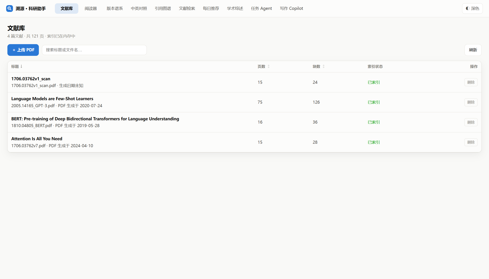

*图 1　文献库：四篇文献，页数、块数、索引状态一眼可见。上传时会自动判定与库里已有论文的关系（重复 / 新版本 / 不同论文），判定依据是正文语义而不是文件名。*

### 2.1 部署形态

单进程、单命令启动。前端是**单文件 HTML**（4100+ 行，无构建步骤），由 FastAPI 的
`StaticFiles` 同源托管；后端运行时依赖共 8 个（`apps/api/pyproject.toml`）。

> 架构图只用 ASCII：等宽字体里中文占两格，混排的框图一排版就错位。
> 模块的中文说明放在图外面。

```
browser
   |
   +-- GET /             --> StaticFiles --> apps/web/index.html  (single file, no build)
   +-- GET /docs         --> OpenAPI
   +-- GET|POST /api/*   --> routers
                               |
       +------------------------+------------------------+------------------------+
       v                        v                        v                        v
  parsing/                 retrieval/                rag/                    agent/
  chunk / OCR /            BM25 / query              answer / verify /       planner /
  tables / figures         expansion / RRF           anchor backfill         10 tools
       |                        |                        |                        |
       |                        |                   guardrails/                   |
       |                        |                   citation match                |
       +------------------------+------------------------+------------------------+
                               |
                               v
              data/papers/*.pdf + *.json   ·   ocr_cache/
                          （磁盘即数据库）
```

四个目录的中文分工：`parsing/` 切块、扫描件 OCR、表格与插图还原；
`retrieval/` 词法检索、检索词扩展、RRF 融合；`rag/` 生成、校验、坐标回填；
`agent/` 两阶段规划与 10 个工具。

### 2.2 为什么是这个形态

| 选择 | 理由（可核对） |
|---|---|
| 单文件前端，不用 Next.js | 评测机器上不需要装 Node；`uv sync` 之后只有一个进程，没有"npm 装不上"这类故障 |
| 自研 planner，不用 LangGraph | 单进程、单用户、9 步上限；工具注册表 + Pydantic 校验已经覆盖"模型给的名字和参数都不可信"，状态机换不来什么却要绑定框架 schema |
| JSON sidecar，不用 PostgreSQL | 没有并发写、没有跨表查询；代价是"删一篇要同时删内存、sidecar、落盘副本"这类一致性坑（E-017 真翻过车） |
| BM25 + RRF，不用 Qdrant + BGE-M3 | 见 §4：18 题评测里没有一个向量配置超过纯词法 |
| RapidOCR，不用 PaddleOCR / Tesseract | 同是 PP-OCRv4 中英模型，纯 wheel 随 `uv sync` 装好；Tesseract 要另装可执行文件与语言包，装不上这条用例就是 0 分 |
| 手写 SVG 出图，不用 Matplotlib | 零依赖、能导出源码、图注里的数字可逐个核验 |

### 2.3 AI 技术方案：选了谁、怎么接、怎么调优

| 环节 | 选型 | 集成 | 优化 |
|---|---|---|---|
| 生成 | DeepSeek-V3 | 只在写结论／综述／框架／图注／翻译时调用，检索与校验不碰模型 | 评测前冻结改写结果（§4.4）；缺 key 时 200 + `degraded` |
| 检索 | BM25 + 单复数归并 + 扩展 + RRF + 离线术语表 | 中文改写可交模型，也可交术语表；模型不可用时后者接手 | 向量通道默认关（§4.2）；改写落盘复用，保证实验可比 |
| Prompt 与守卫 | 固定 JSON，结论必须自带逐字英文引文 | 服务端三级匹配，命中回填 bbox，不命中即拦下 | 截断容错只认前缀（E-002）；12/12 反例被拦 |
| Agent 工具 | 自研 planner + 10 工具 | 工具名与参数逐条过 Pydantic，不合规拒执行并回填错误 | 9 步上限、动态重规划、轨迹全回显 |

---

## 3. 关键技术一：抗幻觉溯源

### 3.1 机制

问答链路是**四段式**，每段都有明确的失败模式：

```
检索 → 生成（带逐字引文） → 校验（三级匹配） → 回填（页码 + bbox）
```

**生成侧的四条约束**（`app/rag/answer.py`）：

1. 证据块**不截断**直接喂给模型 —— 截断是幻觉的第一步（E-002 实证：截断到 150 字符时，
   模型把致谢里的地址当成"代码可用性"的结论，并在 `journalis` 处截断引用）。
2. 模型必须为每条结论附 **25–120 词的逐字英文片段**，不是"第几条证据"这种弱引用。
3. 引文必须在**本轮证据块**中出现 —— 把"引用一段真实但无关的原文"这条路抬高一档。
4. 输出必须是指定 JSON：`{"claims": [{"text": ..., "quotes": [...]}]}`，解析失败即视为无结论。

**校验侧的三级匹配**（`app/guardrails/citation.py`）：

| 状态 | 判据 | 前端呈现 |
|---|---|---|
| `supported` | 引文在词流中**逐字命中**（含行尾断词容错） | 正常展示 + 页码 + 引号原文 + 跳转按钮 |
| `weak` | 只在归一化后模糊命中（大小写/连字符/空白差异） | 展示但标注"模糊命中，原文需人工确认" |
| `unsupported` | 命中不上 | **划掉展示**，并写出拦截原因 |

被拦截的结论**照样渲染在界面上**（带删除线）。理由很直接：抗幻觉如果只是嘴上说，
评委和用户看不到；把拦下来的东西展示出来，防线才是可看见的。

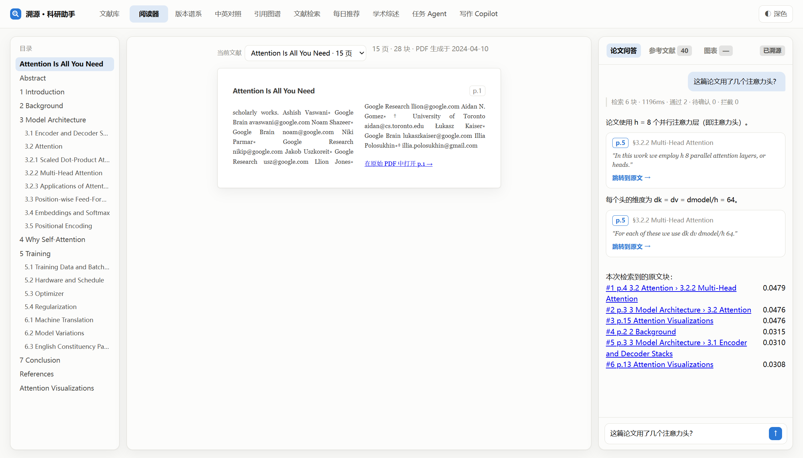

*图 2　`supported` 态。中文提问「这篇论文用了几个注意力头？」，答「h = 8」，右侧每条结论下面挂着页码（`p.5`）、章节路径（`§3.2.2 Multi-Head Attention`）和逐字引文。顶部一行是本次检索的账：6 块证据、1196 ms、通过 2 条、拦截 0 条。*

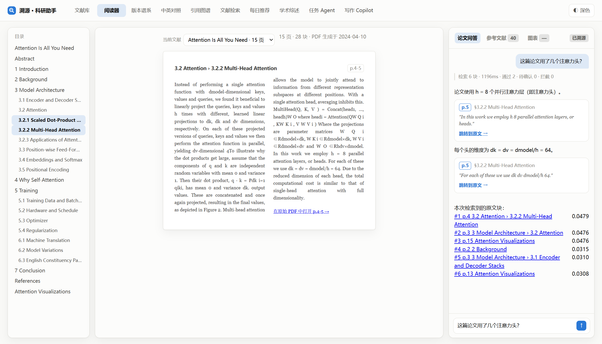

*图 3　点「跳转到原文 →」后，左侧 PDF 翻到 p.4–5 并高亮命中行，目录栏同步高亮 `3.2.2 Multi-Head Attention`。结论、原文、坐标三者对得上，才叫溯源。*

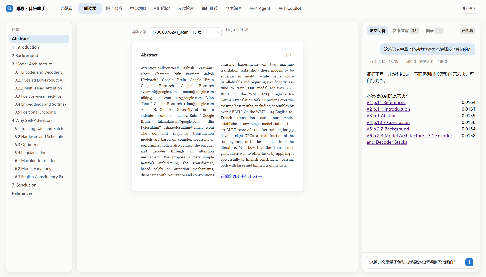

*图 4　问一个论文里不存在的问题（量子色动力学、胶子禁闭）：检索到 6 块、得分都在 0.016 附近、**通过 0 条**。系统不给结论，只把检索到的原文块原样列出，并说明「证据不足」。宁可空手，也不编。*

### 3.2 三个把校验器打回重做的 bug（E-002）

| 现象 | 根因 | 修法 |
|---|---|---|
| 真结论被误杀（Google 授权声明） | 引文在 150 字符处被截断成 `journalis` | ① 证据不再截断 ② 加入截断容错 |
| 篡改引用被判"逐字命中" | 截断容错太粗，`tensor2tensor-api-v2` 砍掉尾巴后匹配成功 | 容错只允许"被丢弃的尾部是原文紧接着那个词的**前缀**" |
| BERT 上真结论 3 条**全部**判 unsupported | 索引按 PDF 原样建词流，行尾断词是 `addi-` + `tion`；切块器早已把证据修成 `addition` | 索引与切块器**共用同一套接词规则**（连字符 + 小写开头才接） |

第三条是最有教育意义的：**索引和切块器对同一段文本的两套理解，才是误杀的真正来源**。
此后所有涉及"同一文本、多种加工"的地方，一律要求共用同一函数。

### 3.3 一个已知边界（诚实声明）

守卫验证的是**引文真实存在**，不是**引文支撑结论**。模型仍可能引用一段真实但无关的原文
来"支撑"一个错误结论。当前的对策是把它限制在"本轮证据块内引用"，失败的代价由
`weak` 状态与人工确认承担。**这是我们明确没解决的问题**，见 §10。

### 3.4 编号是给人看的指针，不是证据的身份

综述里给模型的证据块按 [1..N] 编号，模型只回编号、原文由服务端回填。问题出在
"只回一部分编号"的时候：模型引用 12 条证据里的 11 条（跳过 7），右侧引用栏就会列出
`[1]…[6]、[8]…[12]` —— 读者看到的是"少了一行"，而不是"这一条没被用到"。

修法是在回填前**按引用顺序重排成 1..K**，正文里的编号同步改。判据不变（编号仍然只能
来自本轮证据），变的是呈现：可被核对的证据一条不少，且没有空洞。写作 Copilot 的框架
生成一直是这么做的，两条链路现在一致（E-032）。

### 3.5 跨文献对比：一条结论，两条引用，各回各家

赛题模块二要求"多篇论文跨文献对比"（BERT vs Transformer、GPT-1/2/3 的演进）。
单篇问答那条链路一次只认一篇，所以 `POST /api/papers/compare` 单开一条：
**同一个问题分别去 2–3 篇里各召回一批证据，一次生成，再按各自的原文校验。**

要把"可核对"留在协议里，靠三件事：

| 做法 | 不这么做的后果 |
|---|---|
| 证据块按论文分组编号（`=== 论文 A：标题 ===`、`[A#1] p.3 · 3.1 …`） | 两篇拼成一个长上下文，模型分不清哪句出自哪篇 |
| 每条引用必须自带 `{"paper": "A", "quote": "逐字片段"}`，**没标签的直接丢掉** | 猜一个标签等于把 B 的话算到 A 头上，比没有出处更糟 |
| 校验按各自的 `TextIndex`，锚点带 `doc` 回填出处 | 一条结论同时引 A、B 时，界面上分不清两条锚点各是谁的 |

检索词只扩展一次、各篇共用同一组 —— 分别扩展会让两边召回的
"都是自己那篇的术语"，看着都很有料，实际问的已经不是同一个问题了。

没有 key、模型报错、校验抛异常一律 200 + `degraded` 并把各篇召回的原文照常返回；
检索失败 503，同一篇传两次 400。实测 2 篇 3.3–5.0 s、3 篇 6.9 s（E-038）。

---

## 4. 关键技术二：跨语言检索

### 4.1 起点：词法通道对中文完全失明

用户用中文提问、论文是英文的，BM25 把中文问题切成 **0 个 token** —— 词法通道跨语言失明。
两条路：加向量通道，或让大模型把中文问题改写成英文检索式。

### 4.2 评测集与结论

自建 18 道题（覆盖概念、数值、关系三类），同一套代码、同一组问题：

| 配置 | Hit@1 | Hit@3 |
|---|---|---|
| BM25 单路（原始中文问题，零扩展） | 11/18 = 61.1% | 11/18 = 61.1% |
| 扩展 + RRF（纯词法，单复数归并前） | 12/18 = 66.7% | 17/18 = 94.4% |
| **扩展 + RRF（纯词法，单复数归并后）** | **15/18 = 83.3%** | **18/18 = 100%** |
| 向量单路（同样走扩展 + RRF） | 12/18 = 66.7% | 16/18 = 88.9% |
| 双通道并行 + RRF 等权 | 11/18 = 61.1% | 16/18 = 88.9% |
| 双通道并行 + 向量降权 0.4 | 13/18 = 72.2% | 17/18 = 94.4% |
| 词法召回 → 向量重排（α = 0.25） | 15/18 = 83.3% | 18/18 = 100% |

**三条结论：**

1. **没有一个向量配置超过纯词法。** 等权融合甚至从 83.3% 掉到 61.1% —— 加通道反而倒退。
2. **单复数归并（`attention` / `attention layers` / `heads`）把 Hit@1 从 66.7% 抬到 83.3%**，
   代价是几十行代码，比加载一个 128 MB 的 ONNX 模型便宜得多。
3. 向量通道并非无效：它确实召回了词法通道漏掉的 `Attention Visualizations`（查询写的是单数
   `visualization`），但同时也把无关块排到了第 1。**在 12 篇文献、18 道题的规模上，
   噪声抵消了增益。**

### 4.3 断网也要能用：内置术语表（离线跨语言）

上面那条链路有一个隐藏的前提：**跨语言靠一次大模型调用**。模型限流、超时、没配 key，
中文提问就是 0 召回 —— 而这恰恰是现场演示最可能发生的事。

补上一条不联网的通道：一张"中文术语 → 英文检索词"的表（`app/rag/glossary.py`），
在问题里做**最长匹配**切出术语，拼成英文检索式交给 BM25。不调模型，毫秒级。

| 通道 | 开发集 18 题 Hit@1 / Hit@3 | 留出集 13 题关键词命中 |
|---|---|---|
| 不扩写（零扩展） | 11/18 = 61.1% / 61.1% | 10/13 = 76.9% |
| 只有术语表（不调模型） | 16/18 = **88.9%** / 94.4% | 12/13 = 92.3% |
| 只有大模型改写 | 15/18 = 83.3% / 100% | 13/13 = 100% |
| **模型 + 术语表（线上默认）** | 16/18 = 88.9% / **100%** | **13/13 = 100%** |

**为什么是"并"不是"二选一"**：两条通道错的地方不一样 —— 模型读得懂"会影响吗"这种
因果问法，术语表钉得住专有名词的精确词形。开发集上术语表单独就能把 Hit@1
从 61.1% 抬到 88.9%（比模型的 83.3% 还高），合并后两条都不吃亏。

**留出集**（`scripts/eval_glossary_holdout.py`）是专门用来防"只对调参那 18 题有效"的：
换三篇论文（BERT / GPT-3 / FSA）、换 13 道题、换一个指标（答案关键词是否落在前 6 块里，
不要求命中小节编号）。这 13 道题一道都没参与过术语表的编写。术语表的边界也写在这里：
它只覆盖**名词性术语**，口语化的动词短语（"怎么接的"、"能看出什么"）一律不收 ——
收进来只会把 IDF 压低、把检索式稀释。

### 4.4 评测方法本身的一个教训

第一次跑"扩展 + RRF"得到 Hit@3 = 94.4%，重跑同样的代码却回到 94.4% 附近的不同数字区间；
进一步固定检索式后发现，**等权与加权完全相同**。原因是链路里有大模型，
每次改写出的检索式不同。

> **教训：凡是链路里有 LLM，评测必须先冻结它的输出，否则测的是模型的脾气，不是你的策略。**

此后 `scripts/eval_retrieval.py` 支持把改写结果落盘复用，所有对比都在同一组检索式上进行。

### 4.5 划词翻译：只翻选中的那一句

整篇对照（「中英对照」视图）解决的是"通读"，解决不了"读到某一句卡住"。
后者要的是一个就地入口：选中 2–1200 字符，浮层里给出中文。

`POST /api/translate/en-zh` 的约束与其他翻译接口一致：输出固定 JSON `{"zh": …}`，
LaTeX、代码、`[n]` 标号、数字与缩写原样保留；没 key、超时、空输出一律
200 + `degraded` 并回显原文。超过 1200 字符返回 413 —— 那是"整段"，
该走对照视图，也挡住把接口当翻译机刷。

前端两个坑写在注释里：点按钮会**收起选区**（文字与坐标必须在 `mouseup` 时就存下），
正文是两栏内部滚动（浮层必须 `position:fixed`）。实测选中 150 字符到中文落地 1109 ms（E-038）。

---

## 5. 关键技术三：多模态解析

### 5.1 扫描件：无文字层 PDF

`page.get_text()` 对扫描页返回空字符串，整条链路断在这里。接入 RapidOCR（PP-OCRv4 的
ONNX 版）后重新建词流。

**分辨率不是越高越好**（`scripts/eval_ocr.py`，同一份扫描件，第 1–5 页）：

| dpi | 词级 F1 | 精度 | 召回 | 粘连率 | 字符错误率 |
|---|---|---|---|---|---|
| 48 | 0.476 | 53.0% | 51.0% | 0.1% | 46.8% |
| 60 | 0.835 | 85.8% | 83.4% | 0.1% | 14.1% |
| **72** | **0.866** | **90.6%** | **85.8%** | **0.2%** | **9.2%** |
| 96 | 0.827 | 91.4% | 78.9% | 1.2% | 7.3% |
| 120 | 0.786 | 87.5% | 74.4% | 4.6% | 7.9% |
| 150 | 0.485 | 67.9% | 40.2% | 9.6% | 22.6% |
| 200 | 0.539 | 73.1% | 44.1% | 7.1% | 19.8% |

两条曲线都呈倒 U 形：低于 60 dpi 字糊成一团，**高于 120 dpi 反而掉得比低分辨率更狠**。
解释是模型按固定尺度缩放输入，过大的图被压缩后笔画粘连（粘连率 0.2% → 4.6% → 9.6%
单调上升正好印证）。**默认值因此定为 72 dpi，不是"越高越清楚"的直觉。**

代价：CPU 推理，**单页约 6 秒**，15 页整篇约 72 秒（2 vCPU 实测；2026-11-14 线上复测
3 页冷上传 17.7 秒，含解析、索引、入库）。对策是**结果落盘缓存**，同一份 PDF 只算一次；
界面上如实显示"首次要等，之后秒开"。

扫描件的**标题**也得靠 OCR：文本层抽不出 span，字号那套判据全部落空，而 OCR 的
`size` 是行高像素当量（实测首页上邮箱那行比标题还大），所以判据换成"首页上半部分
最宽且居中的那一行"；OCR 吃掉的空格只在整行一个空格都没有时按驼峰补回来
（`AttentionIsAllYouNeed` → `Attention Is All You Need`）。引文来自 OCR 时，
问答面板会在结论上方注明"正文与引文都来自 OCR 识别"，免得用户对着纸面
核对 `we use d d, dode/h 64` 这种识别残渣，以为系统抄错了。

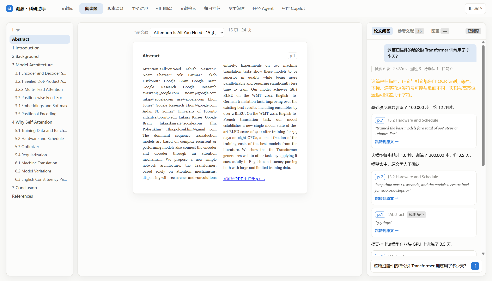

*图 5　同一份论文的扫描件（15 页全部没有文字层，正文全靠 OCR）走完整条问答链路：答出"100,000 步 / 12 小时"与"300,000 步 / 3.5 天"两组数字，每条结论都挂着页码与逐字引文，引文与 OCR 词流逐字一致。面板顶部的橙色说明是"引文来自 OCR"的出处声明 —— 引文里的 `oo0 steps` 正是识别残渣，用户对着纸面核对前就该知道这一点。线上实测：整篇 OCR + 建索引 + 入库 72.6 秒（2 vCPU）。*

### 5.2 表格：把版面还原成行×列

`page.find_tables()` 给的是**网格线**，学术论文的 booktabs 表格只有三条横线
（顶线、中线、底线），没有竖线，于是整张表被识别成"表头一行 + 一个巨大表体格"。

还原策略（`app/parsing/visuals.py`）：

1. 取页面词流 `get_text("words")`，按词中心 x 落进哪个列区间分列；
2. 按词基线 y 分组成"视觉行"（容差为行高中位数的 0.55 倍）；
3. 同一行内的相邻词按间距决定是否粘合（词间空格约 2pt，小数碎片约 0，
   阈值取行高的 0.12）；
4. 缺值的格**留空**而不是左移 —— 错位比丢值更误导人。

效果：GPT-3 的 `Table 2.1` 还原出 11 行 × 5 列，数字各归各位；
Transformer 的 `Table 2` 同样还原成功。

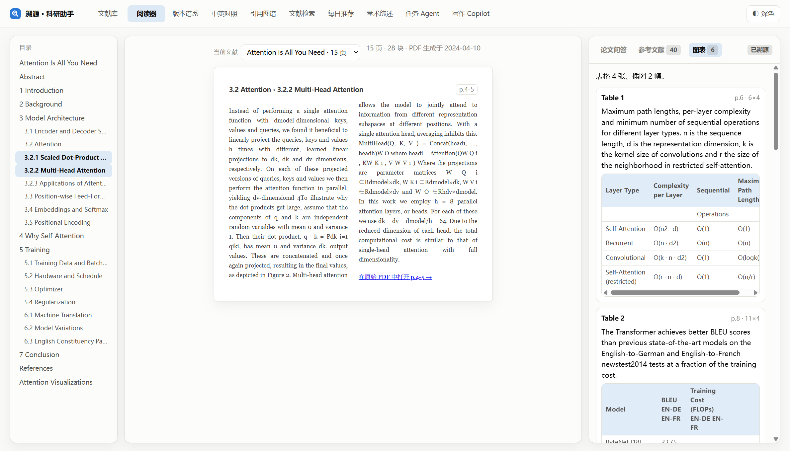

*图 6　「图表」栏。Table 1 原本是三条横线、无竖线的 booktabs 表格，还原后 `Complexity per Layer / Sequential Operations / Maximum Path Length` 三列表头各自归位，四行数据的 `O(n²·d)`、`O(1)` 没有串列。目录行标明来源页码与网格尺寸（`p.6 · 6×4`）。*

### 5.3 插图

`get_images(full=True)` + `get_image_rects(xref)` 定位，按面积过小（图标）与
整页大小（扫描位图）两头过滤，用 `get_pixmap(clip=..., dpi=...)` 出 PNG 缩略图并落盘缓存。

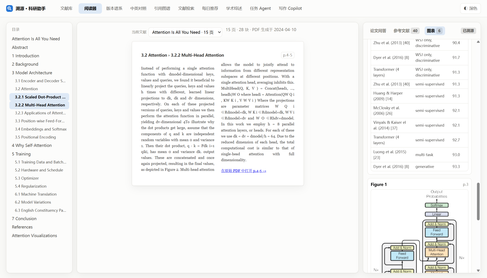

*图 7　插图按面积过滤后单独抽出（过滤掉图标与整页扫描位图），Transformer 架构图里的 `Multi-Head Attention`、`Add & Norm` 等框内文字仍清晰可读。*

### 5.4 章节标题：字号门槛是量出来的

"编号 + 空格 + 内容"这条判据不看字号，图表里的碎字因此会被抓成章节标题
（FSA 论文里冒出 `64 Seqlen (K)`、`2.78 H100 NVL`、`Q3 Q6` 三条）。修法是加前置判据：
**比正文小到一定比例的段落，直接不当标题**。门槛在第一版取 0.9，部署后 FSA 的
**全部子章节一起消失** —— LaTeX 双栏模板的 `\subsection` 本来就比正文小一号。

实测分布（正文 10.0pt）才是依据：

| 类别 | 字号 | 占正文 |
|---|---|---|
| 一级标题 | 9.9 ~ 10.0 | 0.99 ~ 1.00 |
| 真子章节 | 8.41 ~ 8.86 | 0.84 ~ 0.89 |
| 图表碎字 | 3.2 ~ 5.5 | 0.32 ~ 0.55 |

空档在 0.55 与 0.84 之间，门槛落在 **0.7**：同一份 PDF 的章节路径从 17（含 5 条假路径、
2 条子章节挂错父级）收敛到 14（9 条子章节全部归位、0 条假路径）。详 E-027。

### 5.5 图文互链：正文的「Figure 9」与图注卡片之间

表格与插图抽出来之后，它们跟正文之间原本没有任何可走的路：读正文看见
「as shown in Figure 9」，要自己翻到图表栏凭编号找；看着一张表想知道
"作者在哪一节讨论它"，要自己回头搜。两个方向都补上了（纯前端，后端零改动）：

- **正文 → 图表**：正文里的 `Figure 9`、`Table 2.1`、`Tab. 2`、`图 3` 变成虚线链接，
  点击切到图表栏、滚到那张卡片并闪一下；
- **图表 → 正文**：每张卡片底部列出「正文提到：p.7 p.8 p.9」，点击跳回那一块，
  并把编号闪出来。

三条判据决定了它不是"点不动的东西"：

1. **只有解析出图注的编号才可点**。键取自卡片自己的 label（`Table 2.1`），
   正文里的 `Table 2` 若没有对应卡片就不给入口 —— 扫描件（没有文字层）与
   没认出图注的表格都属于这种情况。给一个点了没反应的链接，比不给更糟。
2. **按页去重**。同一页常被切成两块，不去重会看到「p.5 p.5」。
3. **认缩写，但只认带点的缩写**。`Fig. 9`、`Tab. 2` 都算，裸 `tab` 不算 ——
   DiNAT 那篇正文用 22 处 `Tab. N` 引表格，只认 `Table` 时它 15 个编号一个
   都没接上（0/15），补上 `Tab.` 之后 7/15。

**覆盖率实测**（13 篇、125 个不同编号的卡片；`scripts/measure_crosslinks.py`，
判据与前端同源）：补 `Tab.` 之前正文能跳过去 54 张（43.2%），之后 61 张（48.8%）。
没接上的多是真情况 —— 正文只写「the following table」不写编号，或图注编号本身
没解析出来。

分母按**编号**去重而不是按卡片：DiNAT 的四幅子图都标成 `Figure 1`，四张卡片只是
一个跳转目标。同理，**图注自己那一块必须排除**：图注里当然写着自己的编号，
算进去每张卡片都必然"有引用"，量出 130/130 这种看着漂亮、其实什么都没说明的数。

编号索引在**图表栏首次解析完成后**才建立，所以正文里的编号是"先看图表、
再回正文"才可点的：图表解析要十几秒，为了几个链接在打开文献时就跑一遍
`find_tables()`，等于把每个用户都拖进那个等待里。

### 5.6 作者与机构：只认版面，认不出就留空

赛题模块一列的第一项是「标题、**作者及机构信息**、摘要、章节树、表格、图表、
公式、参考文献及附录」。这一项我们补得最晚（E-039），原因是它看着容易、其实
处处是坑：`pdf/` 里七份样本，首页版式就有七种。

判据只有一条 —— **版面几何**，不碰元数据（arXiv 的元数据标题常年是错的，
这一条在标题识别时已经吃过一次亏）。首页标题的**底边**到「Abstract」之间那一块，
按行的形状分三类：

| 行 | 判据 | 例子 |
|---|---|---|
| 邮箱行 | 含 `@` | `avaswani@google.com` |
| 机构行 | 含机构词（University / Google / Institute…），≤ 8 个词 | `Google Research` |
| 人名行 | 2~5 个词、首字母大写、无数字 | `Aidan N. Gomez` |

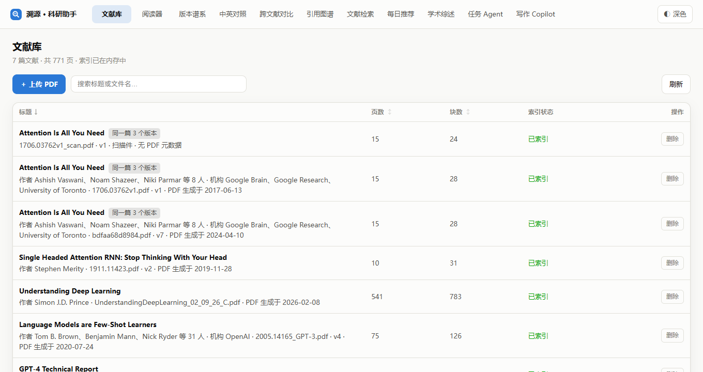

四个真实样本定住了这块逻辑的边界：

- **中间名缩写不是句子结束**。`Tom B. Brown` 里的 `B.` 一度让整行被判成
  "两句话粘在一起"（脚注正文 `Equal contribution. Listing order…` 就是这个形状），
  GPT-3 的第一作者因此整行消失。改判据：句号前那个词是**短的纯大写**（`B.` / `J.D.`）
  才算缩写，否则算句子结束。
- **标题第二行不能当作者**。BERT 的标题占两行，`Language Understanding` 单看
  形状是个两位的"人名"。上界取标题最后一行的**底边**，不是第一行的顶边。
- **封面不列人名就真的没有**。GPT-4 技术报告首页只印了 `OpenAI∗`，一位作者也没写。
  所以库里它的作者列表是空的、机构是 OpenAI —— 这里没有从机构名"推断"出团队，
  也没有拿正文里出现的名字凑数。
- **扫描件留空**。OCR 认人名会错（`0`/`O`、`rn`/`m`），而作者名是要给人看的，
  错一个字就是把另一个人认成了作者。所以扫描件返回空列表，界面不写「作者未知」，
  那一行直接不出现（上图第一行就是扫描件，与下面 v1 形成对照）。

七份样本的实测结果：Transformer v1/v7 八位作者、三家机构（五处 `Google Brain`
去重成一条）；BERT 四位作者、一家机构；GPT-3 三十一位作者、OpenAI；
GPT-4 零位作者、OpenAI；`Understanding Deep Learning` 作者 `Simon J.D. Prince`、
无机构（它的机构写在致谢里，不在首页）；扫描件两项皆空。

代价是明确的：机构词的词表是手写的，`Max Planck Society` 这类表述认不出来。
宁可不认，也不猜 —— 猜错机构比不写更糟，因为它看着像真的。

### 5.7 公式：只认作者写了编号的那些

赛题模块一要求「LaTeX 公式」。先把一件容易含混的事说清：**PDF 里的公式是排好版的字形，
不是 LaTeX 源码**。同一处公式，肉眼看到的和文字层给的：

| 版面 | 文字层 |
|---|---|
| softmax(QK^T／√d_k)V | `softmax(QKT` + `√` + `dk` + `)V`（上标 T 被摊平，根号没有 ToUnicode 映射） |
| 两行求和：L[ϕ] = Σ(f[xᵢ,ϕ] − yᵢ)² | `f[x, ϕ] y = = ϕ0 + ϕ1x.`（分式横线不是字，分子分母的读序被拼在一起） |

要真的 LaTeX，得靠数学 OCR（pix2tex 一类）或 arXiv 的源码包，两样都没做，也不假装做了 ——
拼一串看着像 LaTeX 的东西出来，比不给更坏。

所以这一层给四样东西（`app/parsing/formulas.py`）：**第几页**、**编号**（式 (1)）、
**包围盒**（前端按它从原版面裁图，图是准的），以及一段**明说有损**的文本层。

**判据只有一个：右边缘那个孤零零的 `(1)`。**

- 编号是作者给的，不是我们猜的 —— 认到 `(2.1)` 就是作者写的第 2.1 式；
- 无编号的居中公式要靠"数学字体占比 + 短行 + 上下留白"去猜，实测会把表格里的
  `6.0 × 10−4`、表头 `nparams` 认成公式。宁可一个不认，也不要把表格单元格指成公式。

公式体怎么收：先按**同一栏**取左边（右边缘和编号对齐的那些正文行里，最左的那个起点 ——
不这么取，`Understanding Deep Learning` 的式 (2.3) 会把左栏的 `Argmin function`
一起框进来）；窗口按**编号行高**伸缩（写死 14pt 会把根号下面的分母漏在框外）；
再上下、并排接**紧贴着**的数学行（求和的上下限、分式的分子分母都在独立的行上，
UDL 的式 (2.5) 一开始就丢了求和上限 `I` 和等号左边的 `L[ϕ] =`）。

**实测（七份样本）**：

| PDF | 编号公式 | 说明 |
|---|---|---|
| Transformer v7 | 3 —— 式 (1)(2)(3)，p.4 / p.5 / p.7 | |
| Transformer v1 | 3，同编号，p.3 / p.5 / p.7 | 版式不同，编号一致 |
| Understanding Deep Learning | 8（式 2.1–2.6、3.1、3.2） | 541 页的教材，只解析前 40 页 |
| BERT / GPT-3 / GPT-4 | 0 | **本来就没有**编号公式（全篇搜不到孤立的 `(N)` 行） |
| 扫描件 | 0 | 没有文字层，也就没有字形可认 |

"0 个"和"解析失败"是两件事，所以 `note` 分三句话讲：没有找到带编号的公式 / 扫描件提不出 /
只解析了前 N 页。界面上照这个原话写，不写"解析失败"。

耗时 9 ms（扫描件，直接判空）到 2.06 s（GPT-3 前 40 页），命中缓存 12 ms。
它和 `find_tables()`（同一份 541 页教材 21.4 s）差着三个数量级，所以图表栏是
**分开拉、谁先回谁先画**：公式 0.1 秒就位，表格与插图随后补上，等待期间那一格写
"正在解析表格与插图…"，而不是让快的陪着慢的排队。

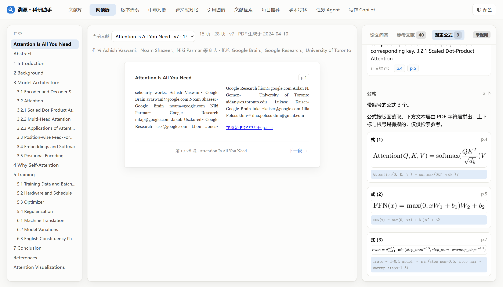

*图 14　「图表公式」栏的公式段。Transformer 的三条编号公式各自成卡：图是**按包围盒从原版面裁的**，
上下标、根号、分式横线原样保留；卡片下方灰底那行是文字层 —— `softmax(QKT √dk )V`，上标的 T 被摊平、
根号与下标挤成一串。两者一起给，是因为前者准确、后者可检索，而谁也不会把灰底那行误当成能直接排版的源码。*

### 5.8 CSV → 图：图注里的每个数字都要能核验

赛题模块六要「读 CSV → 出图 → 提炼符合学术规范的 Figure Caption」。图容易画，
**图注才是容易出事的地方** —— 一句"提升了 42.7%"如果模型算错了，读者没有任何办法发现。

所以图注走的是和正文结论同一套规矩（`app/analysis/chart.py`）：

1. 先把统计口径固化成一张"数字卡片"：每个系列的最大 / 最小 / 均值 / 首个 / 末个、
   相差百分比、样本量。**这张卡片是模型唯一被允许引用的数字来源**；
2. 模型写完之后逐个数核验：出现在卡片里的留下，不在的换成 `[未核实]`；
3. 超过一半的数字是编的，就整段退回模板 —— 模板只陈述观测值（"最高 X、最低 Y、
   相差 Z%"），并显式声明"不含误差棒，差异是否显著需另做检验"。

界面上同时标出这句话的可信度：模型图注没有任何可核验数字时，说明会写在图注下方
（"已整体改用模板图注"），而不是悄悄替换掉让人以为那段是模型写的。

**图本身手写 SVG，不用 Matplotlib**：零依赖、输出完全确定性（没有时间戳、没有随机 id，
测试可以逐字比较），而且**能同时导出三份源码** —— Mermaid、TikZ（pgfplots）、
Matplotlib 脚本，赛题「CSV 图表转化为 TikZ/Mermaid」那个测试项就在这儿落地。
两条硬约束：绝不双 Y 轴（两个量纲拆并排小图）、分类色板固定顺序不循环。

实测：4 行 CSV → 建表 + SVG + 图注 + 三份源码 **1.1–1.6 秒**（含一次模型调用）；
三个下载按钮在真浏览器里点过，落盘分别是 `.mmd`（172 B）、`.tex`（854 B）、`.py`（4.5 KB）。

**数据去了哪里，得说准**：原始 CSV 行留在浏览器与本机后端进程里，不落盘、不进文献库；
写成图注的那一次模型调用只收到**统计卡**（聚合后的最大 / 最小 / 均值 / 样本量），
不收到原始行。这一条在早期版本的实验记录里写成过"CSV 不出这台机器"，
后来加了服务端核验就不再成立，已在 E-008 里更正。

---

## 6. 关键技术四：Agent 编排

### 6.1 结构

- **两阶段规划**：先出计划（步骤列表）→ 再据当前证据决定下一步，支持**动态重规划**；
- **10 个可调用工具**：检索、读原文块、抓论文、回答、版本比对、搜索站点、抓 arXiv、
  引用图谱、表格查询、图表生成；
- **参数校验**：每个工具一张 Pydantic 模型，工具名或参数不合规**拒绝执行**并回填错误给模型；
- **步数上限 9 步**，防止在某个循环里出不来；
- 每一步的执行轨迹（工具名、参数、耗时、返回摘要）都渲染在界面上 —— 编排过程可见。

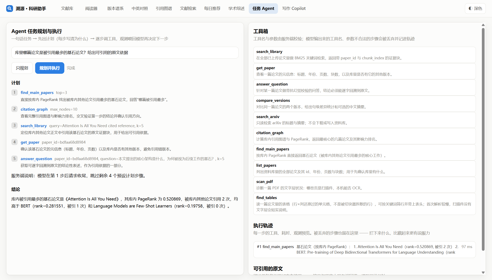

*图 8　一句话任务「库里哪篇论文是被引用最多的基石论文？」。左边是 5 步计划，每步写明为什么这么走；模型在第 1 步（`find_main_papers`）拿到结果后主动请求收尾，服务端把"跳过剩余 4 步"如实写出来 —— 计划不是演给人看的剧本。右边是 11 个工具的 schema 与执行轨迹（工具名、耗时、观测摘要）。*

### 6.2 为什么不用框架

LangGraph 这类框架提供的核心价值是状态机与时序控制。本系统的场景是单进程、单用户、
最多 9 步的线性推进，**自研 planner 约 300 行即可覆盖**，换来的是：

- 工具 schema 完全由自己的 Pydantic 模型定义，不经过框架二次翻译；
- 失败时可以精确控制"重规划还是直接降级"；
- 不引入额外依赖，部署时少一个"起不来"的可能。

---

## 7. 关键技术五：版本感知与引用图谱

### 7.1 版本判定靠标定，不靠直觉

同一篇论文的 v1 与 v7，5-gram Jaccard 为 **0.6836**；v7 与另一篇 BERT 论文为
**0.0033**。阈值取 0.30（判疑似重复）与 0.05（判不同文献），中间灰区交给 arXiv 号、
标题、摘要二次确认。

| 比较 | 5-gram Jaccard | 判定 |
|---|---|---|
| Transformer v1 ↔ v7 | 0.7032（全文归一化后） | `new_version` |
| Transformer v7 ↔ BERT | 0.0033 | `distinct` |

版本差异里最有用的一条：**引用从 36 条增到 40 条**，与"v7 补充了引用"这一
公认事实一致 —— 这是判定结果可信的旁证。

**谁新谁旧同样要靠依据，不能靠"哪个后传"**。判据按 `arXiv 版本号 → PDF 生成日期 →
上传时间` 三级降级，并把用的是哪一级写进响应（`order_by`）：

- 同一篇（arXiv 号一致）且两边都取得到 `vN` → `vN` 小的在前。日期只精确到天，
  同一篇的两个版本常常同一天导出；扫描件更是连元数据日期都没有；
- 两份生成日期都有 → 日期早的在前；
- 两样都没有 → 只能按上传时间，前端照实写"这里按上传时间排，不代表论文本身的先后"。

判据抽成一个共用函数，HTTP 接口与 Agent 工具都调它 —— 早先两处各写一遍，
同一对扫描件在两条路上判出的新旧是相反的。

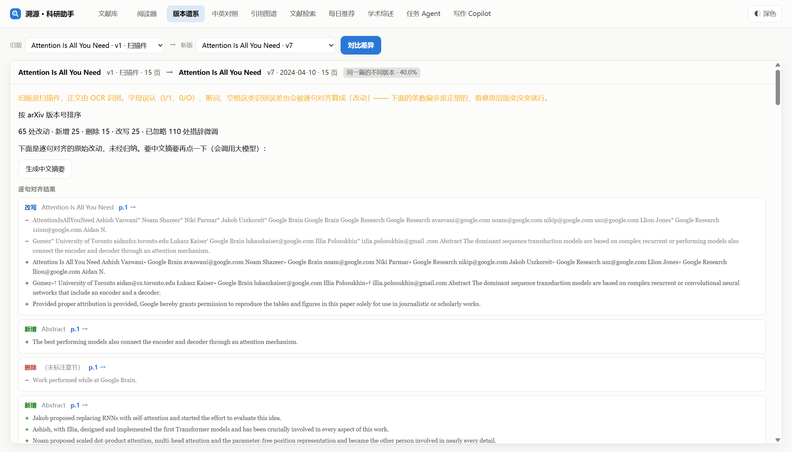

*图 9　把 v7（文字层 PDF）与同篇的扫描件放进版本谱系：判定"同一篇的不同版本 · 40.0%"，新旧按 arXiv 版本号排（v1 → v7），列出 65 处逐句差异、另有 110 处措辞微调被忽略，并可让模型归纳成中文摘要。扫描件那一侧的正文由 OCR 识别，界面因此把"识别误差也会被算成改动"写在差异列表上方。跨来源对齐能拿到 40% 的重合度，说明版本判定不依赖文件来源，只看正文。*

### 7.2 引用识别与 PageRank

参考文献解析要应付三种标记风格（数字 `[1]`、字母数字 `[VSP+17]`、ACL 体无标记），
解析出的标题与库内标题做 Jaccard 比对：

| 样本 | 标题 Jaccard |
|---|---|
| 真引用 | **1.00** |
| 最像的假引用（GPT-2 撞库） | 0.50 |

阈值取 **0.70**，两边都有余量。库内引用关系图上的 PageRank 为手写实现（不引 networkx），
用于回答"我库里哪些论文是奠基性的"。

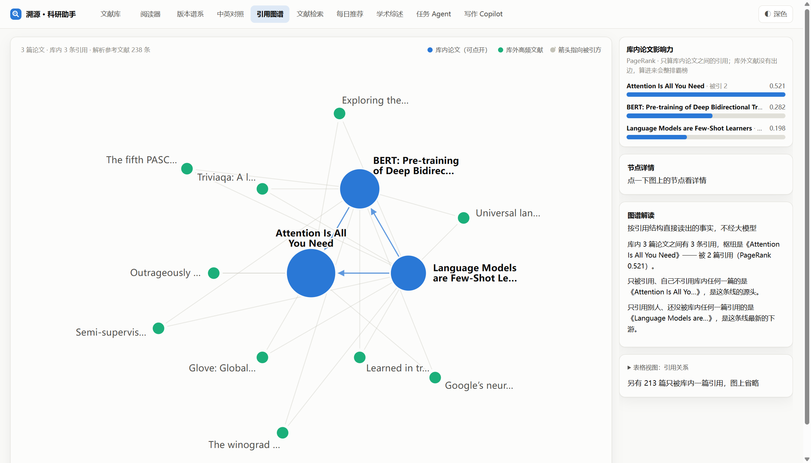

*图 10　库内引用图谱：蓝点可点开，绿点是库外高频文献，箭头指向被引方。右栏是 PageRank 排名（只算库内论文之间的引用 —— 库外文献没有出边，算进来会整排霸榜）。下方的「图谱解读」是按引用结构直接读出的事实，不经大模型：谁被引最多、谁是源头、谁是最新下游。*

四个被数据打回的直觉（E-006）：附录里的 References 会一起被解析（BERT 65 条、GPT-4 194 条）；
"句点 + 空格"切条目会把两条吞成一条；年份取第一个四位数会把 arXiv 号当出版年；
论文年份取 PDF 生成日期会让图谱上出现"Attention Is All You Need (2024)"。

### 7.3 引用含金量：库外的被引次数

PageRank 量的是**库里**谁被引得多，回答"我的文献里哪篇是奠基性的"；
「引用含金量」量的是**库外**一篇论文被引了多少次，回答"这个方向哪个工作是绕不过去的"。
两者是同一件事的两个方向，所以放在同一节。

三个来源各用各的字段名，读数收口在一个函数里：

| 来源 | 字段 | 说明 |
|---|---|---|
| OpenAlex | `cited_by_count` | 覆盖最全，通常也是最大的那个数 |
| Crossref | `is-referenced-by-count` | 只统计登记了引用的出版方，系统性偏低 |
| Semantic Scholar | `citationCount` | 需 key，公共配额常年被占满 |
| arXiv / Zenodo | —— | 接口根本不提供这个字段 |

因为口径不同，`0` 的含义必须是**这个站没给数**，而不是"没人引过"。
规则有三条：`_cited()` 把 `None`／空串／`"N/A"`／负数一律收成 `(0, "")`；
`citations_source` 记下这个数出自哪个站（界面上写"被引 136,007（OpenAlex）"）；
去重合并时**取各站里最大的那个**并让出处跟着胜出的数走（取最小会把高被引论文
系统性地压下去；打平时保留先出现的站，这样同一批结果刷两次不会跳动）。

筛选是**在当前这批结果里筛**，不是再查一遍：门槛分四档（不限／≥10／≥100／≥1000），
点一下换成它；状态行写的是"23 条结果 · 按被引 ≥ 100 筛出 5 条 · 18 条带被引数"。
没有数的那 5 条确实过不了门槛，但**不能让他们悄悄消失** —— 那会让人以为这 5 条不存在，
所以结果区明说"没有被引次数的结果（arXiv、Zenodo 不提供）一并不在其中"；
一条都不过线时同样给一段说明，而不是留一片空白。

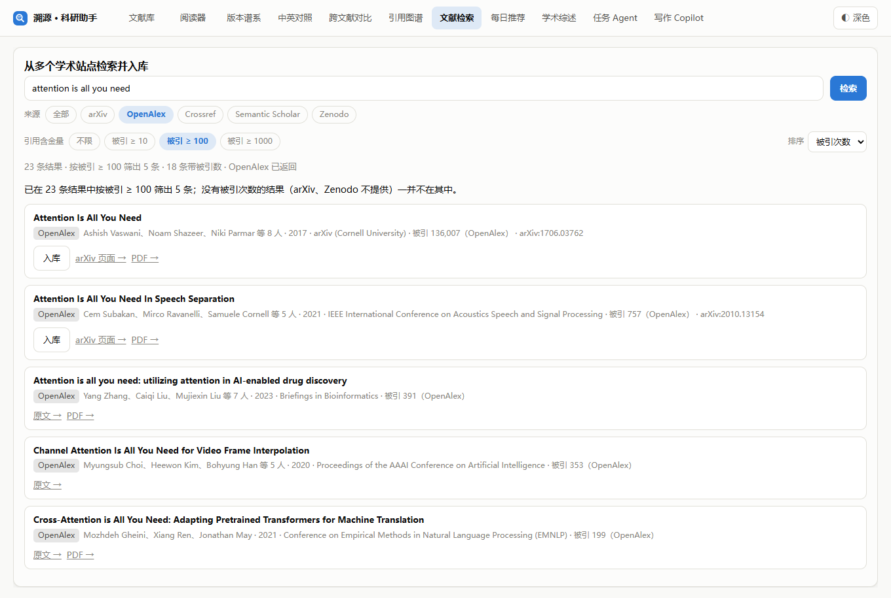

*图 13　「Attention Is All You Need」23 条结果里，18 条带被引数；按被引 ≥ 100 筛出 5 条并按被引降序排列。被引数后面跟着出处，因为三个站口径不同，它不是一个唯一真值。*

### 7.4 arXiv 定期追踪：记得"见过"才叫追踪

模块四的另外半句是「arXiv 定期追踪」。它和上一节的区别不是界面，是**状态**：

- 「每日推荐」每次打开都现算一遍，**没有记忆** —— 两小时后再看还是那批，说不上"新"；
- 「订阅追踪」记得**哪些已经见过**，所以"新增 2 条"是一个能被证明的说法。

没有那张已见集合，每隔六小时抓一次、抓回同一批 40 条，写"新增 40 篇"就是在骗人。
新增的定义只能是"我没见过"。

三个东西存在同一份 JSON 里，各管一件事（`app/tracking.py`）：

| 字段 | 是什么 | 为什么不能合并 |
|---|---|---|
| `tracks` | 订阅：分类 + 关键词 + 间隔 | 用户设的，删了就没了 |
| `seen` | `arxiv_id → 第一次见到的时间` | **只增不减**，是"新增"的唯一依据；条目表被截断也不会让它失忆 |
| `items` | 抓回来的条目，最新在前，200 条封顶 | 可以截断、可以重来，丢了不影响判断 |

四条规则，每一条都对应一种被数据打回来的直觉：

**1. 第一轮是基线，不是"新增 20 篇"。** 刚建的订阅拿回来的是"现在这一批"，
把它算成新增等于每次新建订阅都先撒一次谎。首轮只把 id 记进 `seen`、条目照列，
新增数记 0，状态写 `baseline`，界面上说"首次抓取，作为基线记下 4 条，不计入新增"。

**2. 抓取失败也要写 `last_run_at`。** 不写的话调度器会在限流期间每分钟重试一次，
自己给自己加码（arXiv 429 实测要等 50 秒才回）。失败只影响这一轮，`seen` 一条不动，
`last_status` 写成 `degraded`，界面把原因原样显示出来。

**3. 关键词要"至少命中两个"，不是"任一词命中"。** 实测（同一批 40 条最新投稿）：
`retrieval augmented generation` 按任一命中留下 10 条，其中一半是"视频生成"——
它们只命中了 `generation` 一个词。常见词（generation / learning / model）会让"任一"
等于不筛。但也不能要求全中：四个分类一天四十条，全中的话绝大多数订阅永远抓不到东西。
折中是"至少两个词，单关键词时就是那一个"。

| 关键词 | 任一词 | 至少两个 | 两个且有一个在标题里 |
|---|---|---|---|
| diffusion model | 25 | 4 | 3 |
| reinforcement learning | 8 | 3 | 1 |
| long context | 12 | 1 | 0 |
| retrieval augmented generation | 10 | 1 | 0 |
| chain of thought | 1 | 0 | 0 |

最后一列最准，但今天这批会把前三个订阅筛成空的 —— 关键词是启发式，不是语义匹配，
这一点在局限性里写明，不假装它是相关性排序。

**4. "看过了"是一次显式的 POST，不是 GET 的副作用。** 把标记已读塞进 `GET /api/tracking`
少一次请求，但刷新两次页面徽标就没了，"新增"于是变成"上一次刷新之后新增"，
没人讲得清那是什么。所以前端画完这一屏再发 `POST /api/tracking/ack`。

定时器是 `lifespan` 里的一个 asyncio 任务：每 60 秒醒一次，把到期的订阅丢进线程里跑
（抓取是阻塞的网络调用，不能卡事件循环）。`PAPER_TRACKING_SCHEDULER=0` 可关，
测试里默认关 —— 单测不该因为有人建了一条订阅就去连 arXiv。

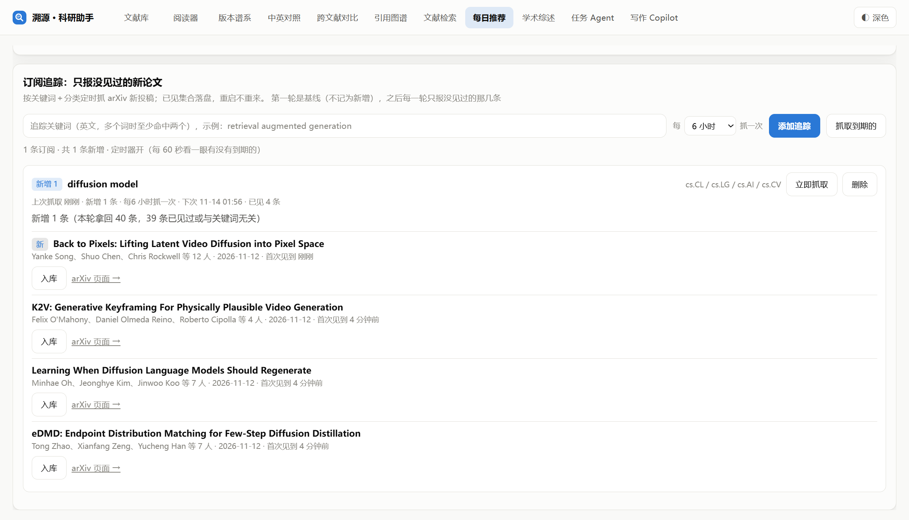

*图 15　「订阅追踪」：关键词 `diffusion model`、每 6 小时抓一次。上一轮已经见过那 3 条，
这一轮只报 1 条新增（`新增 1` 徽标 + 条目上的「新」），状态行同时写着"本轮拿回 40 条，
39 条已见过或与关键词无关" —— 分母也交出来，读者才知道这个"1"是在什么范围里数出来的。*

### 7.5 推荐排序：相关性为主，口味只加一成

「每日推荐」的分数是三样东西手调出来的：`0.75×相关性 + 0.20×有代码 + 0.05×新鲜度`。
相关性是词面余弦、0.5 做归一化上限；代码那一项对应赛题的"优先推荐易复现的"；
新鲜度只用来在同一条水平线上分先后。**权重不是学出来的**，理由在 `app/recommender.py`
开头：这个系统的说服力来自"能解释为什么推给你" —— 理由同样不交给大模型，
每一条都是模板拼的、每个数字都能追到具体来源（「与库内《X》词面重合度 0.16；另与 2 篇
库内文献词面匹配；摘要里给出了开源代码 …；昨日提交」）。

**多用户：点赞要能影响下一次排序，否则它只是个计数器。**

投票本来就按用户分开存（`{arxiv_id: {user: up|down}}`），但 E-043 之前它只用来
亮按钮、报计数 —— 用户投完看不出任何变化。现在补上后半段：投票那一刻把**标题**
一起记下来，用点赞过的标题切出的词做一份"口味画像"。

| 规则 | 做法 | 为什么 |
|---|---|---|
| 口味怎样进入排序 | `score × (1 + 0.15 × 口味匹配)` | 加成而不是加项：相关性是主线，口味只该在同一条水平线上分先后 |
| 口味匹配怎么算 | 候选词与"点赞过"的余弦，减去与"踩过"的余弦（不减成负数） | 一次误点的代价不该是"这篇永远垫底" |
| 什么时候才算成形 | 点赞 ≥ 2 篇 | 点一次就改排序，那叫过拟合，不叫个性化 |
| 界面怎么说 | 状态行写"已按 N 篇点赞调整排序"，理由里写"与你点赞过的 N 篇口味匹配 0.29" | 个性化一旦不可见，就等于没有 |

实测（2026-11-13，本机）：点赞两篇之后，相似候选的分数从 0.2541 抬到 0.2922
（正好是 15% 的上限），**排名没变** —— 前两名相关性本来就高。口味能改先后，改不了主线（E-043）。

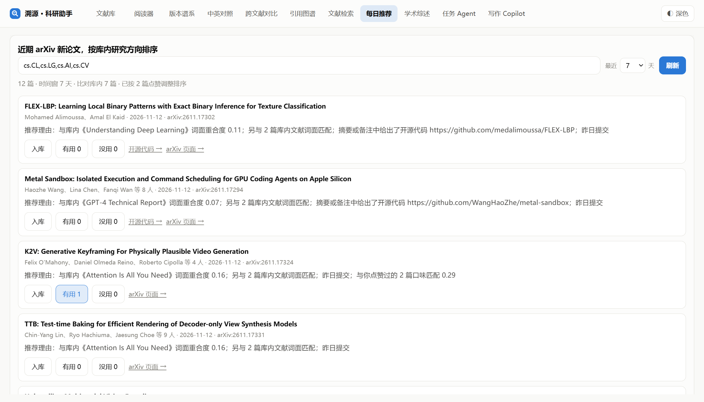

*图 16　状态行写着"已按 2 篇点赞调整排序"；被点赞那条的按钮是按下状态（有用 1），
理由末句是口味匹配度。前两名没有这句 —— 它们和点赞过的论文不像，就不硬凑一句。*

---

## 8. 工程实现

### 8.1 质量与可复现

| 项 | 数值 |
|---|---|
| 自动化测试 | **572 项通过**（`uv run pytest -q`） |
| 键盘可达 | 导航、文献库每行、参考文献行、PageRank 榜都 Tab 得到，Enter／空格激活；实测按 Enter 从 `p.1` 跳到 `p.3`（E-033） |
| 运行时依赖 | 8 个 |
| 启动 | `./scripts/dev.sh`（Windows 用 `.\scripts\dev.ps1`），唯一前置是 `uv` |
| 部署 | `./scripts/deploy_remote.sh`，一条命令打包→上传→装 Docker→加 swap→构建→探活 |
| 实测内存 | 冷启动 13 MB；导入应用后 251 MB；3 篇索引完成后 385 MB；**13 篇（260 页 / 531 块）569 MB** —— 约 12 MB／篇（2C4G 机器，E-026） |
| 演示库现状 | **14 篇 / 265 页 / 538 块**。第 14 篇《GLU Variants Improve Transformer》是 2026-11-10 走「每日推荐 → 入库」加进来的，留作那条链路线上验证的实物（E-033） |
| 首次构建 | 改用阿里云 Debian 源后 6 分钟（原 13 分钟里 12 分钟耗在 `deb.debian.org` 拉 10 MB 的 `libgomp1`，实测 13.8 kB/s；换源后同一文件 3.0 MB/s） |

### 8.2 降级策略

| 缺失的东西 | 系统的行为 |
|---|---|
| `DEEPSEEK_API_KEY` | 服务照常启动，`/api/health` 返回 `llm_configured: false`；综述／框架／图表／中译英／跨文献对比返回 200 + `degraded`，问答返回 503 且界面写明原因（E-036） |
| 向量模型 `models/bge-small-en-v1.5` | 关闭向量通道，走纯词法 BM25（本就是默认路径） |
| OCR 被显式关闭（`RAG_OCR=off`） | 扫描页如实报 `ocr_available=false`，**不假装识别成功** |
| 网络受限（arXiv / Semantic Scholar） | 该来源标注"暂不可用"，其余来源不受影响 |
| arXiv 限流（追踪那一轮） | 返回 200，`last_status=degraded` + 原因，订阅与已见集合一条不动，`last_run_at` 照样前进（否则每分钟重试一次） |

原则一句话：**宁可少答，不可假答；宁可降级，不可白屏。**

### 8.2.1 限流：宽到演示碰不到，窄到滥用撞墙

公网 IP 后面是一个付费模型，没有配额等于把密钥交给路过的人。实现是**按来源的令牌桶**
（`app/api/ratelimit.py`），默认每分钟 60 次、突发 10 次：

| 请求 | 计费 |
|---|---|
| `GET` 全部 | 0（读内存索引，纳秒级；限它只会让"刷新一下"撞墙） |
| 一次问答 / 综述 / Agent / 翻译 | 1 |
| 一次上传（解析 + 可能 OCR） | 3 |
| 批量上传 | 6 |

用"令牌"而不是"每类一个配额"，是因为上传和问答要记在同一份额度上 ——
否则刷上传的请求永远撞不到问答题目的限额。被拦下时给的是**人话 + 可执行的等待秒数**：

```
HTTP/1.1 429 Too Many Requests
Retry-After: 2

{"detail": "请求过于频繁，请约 2 秒后再试。"}
```

三个工程细节：**桶按时间回填而不是按请求数**（撞墙后狂点没有用）；
**用纯 ASGI 中间件**而不是 `BaseHTTPMiddleware`（后者会多包一层任务组，SSE 流式响应
可能被缓冲）；**key 优先取 `X-Forwarded-For` 的第一个地址**（代理链最左边才是真实客户端，
取右边等于给所有人发同一个 key）。

实测：容器里看到的对端是真实地址（`218.2.220.26`），所以按来源限流是真的生效；
连打 14 次，第 4 次开始 429。`scripts/eval_qa.py` 跑 24 题是"人不会这样点"的突发流量，
它**按 `Retry-After` 等**，而不是要求服务端给自己的评测开后门（E-029）。

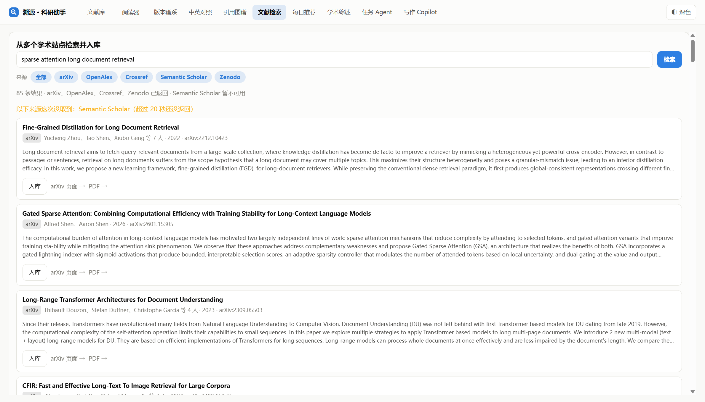

*图 11　一次问五个站：85 条结果，arXiv / OpenAlex / Crossref / Zenodo 已返回，Semantic Scholar 未配 API key 被限流 —— 界面上直说"哪几个来源这次没取到、为什么"，而不是把整页变成空白或假装只有 3 个来源。*

### 8.3 部署（2026-11-07 实测）

阿里云 ECS（华东1 杭州，`ecs.u1-c1m2.large`，2 vCPU / 4 GiB，Ubuntu 22.04），
Docker 两阶段构建，容器内以 `appuser`（uid 10001）非 root 运行，端口 8017。

第一次真机部署连撞五个坑，全部已修进仓库（E-020）：

1. `tar --exclude='.env.*'` 把 `.env.example` 一起排除了；
2. `mkswap -q` 在 Ubuntu 22.04 的 util-linux 2.37 上不存在，且失败后脚本没停、还谎报"已加 swap"；
3. **镜像里对挂载点的 `chown` 是无效的** —— `./data` 是 bind mount，运行期被宿主机目录盖住，
   容器无限重启在 `PermissionError: '/app/data/papers'`；
4. `docker compose restart` **不重读 `env_file`**，改完密钥仍是 `llm_configured: false`，
   必须 `up -d --force-recreate`；
5. 国内 `deb.debian.org` 只有 13.8 kB/s，而 `uv sync` 走清华源只要 18 秒。

---

## 9. 评测汇总

| 维度 | 指标 | 结果 |
|---|---|---|
| 检索（18 题） | Hit@1 / Hit@3 | 88.9% / **100%**（纯词法 + 扩展 + RRF + 单复数归并 + 术语表） |
| 跨语言（离线） | 不调模型时的中文召回 | 开发集 Hit@1 88.9% / Hit@3 94.4%；留出集 12/13 = 92.3% |
| 跨语言（融合） | 线上默认口径 | 开发集 Hit@1 88.9% / Hit@3 100%；留出集 13/13 = 100% |
| 溯源校验 | 三态分布可解释 | 逐字命中 / 模糊 / 拦截，拦截原因逐条可见 |
| 引用含金量 | 带被引数 / 一处来源 | 五站 73 条里 27 条有数（OpenAlex 18、Crossref 9），arXiv 与 Zenodo 结构性缺失；最高 136,007（E-040） |
| arXiv 定期追踪 | 新增数可复算 | 首轮基线 10 条（40 条里）记 0 新增；同一批再抓一次新增 0；重启后订阅与已见集合都还在（E-042） |
| 多用户口味排序 | 点赞前后分数与名次 | 两篇点赞后，相似候选 0.2541 → 0.2922（×1.15 上限内），名次未越过相关性更高者；点赞不足两篇不生效（E-043） |
| 版本判定 | 同源 / 异源分离度 | 0.7032 vs 0.0033 |
| 引用识别 | 真/假引用分离度 | 1.00 vs 0.50，阈值 0.70 |
| 扫描件 OCR | 词级 F1（72 dpi） | 0.866（字符错误率 9.2%） |
| 表格还原 | 行×列正确归属 | GPT-3 Table 2.1 → 11 行；Transformer Table 2 → 11 行 |
| 公式块 | 编号 + 页码 + 可裁的包围盒 | 七份样本 14 个；BERT / GPT-3 / GPT-4 是"本来就没有"，扫描件提不出（E-041） |
| 解析耗时 | 首解析 / 命中缓存 | 3.2 s（15 页）/ 0.00 s；10.6 s（75 页前 40 页） |
| 工程 | 测试 | 572 项全通过（干净 clone 无演示 PDF 时 241 通过 / 330 跳过，跳过原因写明缺哪个文件，E-036） |
| 部署 | 端到端 | 公网问答实测：答"h = 8"，回溯第 5 页，`exact: true`、`similarity: 1.0` |
| **端到端（24 题人工标注）** | **引用准确率 / 拒答正确率** | **52/52 = 100% / 9/9 = 100%**（2026-11-11 从干净 clone 复跑，E-036；11-07 首次为 53/53，差的一条来自库里多了一篇 GLU 论文） |
| 规模（7 → 13 篇） | 同一套题单的稳定性 | 引用 53/53、拒答 9/9 不变，中位 1851 → 2005 ms（E-026） |
| 规模（11 个视图） | 全部可用 / 最慢 | 11/11 返回 200；最慢为综述 13.5 s，中位 1.2–1.4 s |
| **核验器反向对照** | 故意改坏的引用被拦下 | **12/12** |
| **端到端耗时** | 单题中位数 / 最长 | 1851 ms / 5157 ms（2C4G 阿里云）；11-11 复跑 1999 ms / 5597 ms（E-036） |

关于最后三行要补一句方法论：**引用准确率不是采信接口自报的 `exact` 字段**，
而是把 PDF 下载下来自己重算 —— 引文字符流能否在所指页原样找到、bbox 能否盖住引文首尾字。
"100%"的说服力不在 100% 本身，在于同一个核验器把 12 条故意改坏的引用全部拦下（`scripts/eval_qa.py`）。

---

## 10. 局限性与未做的事

**这一节不是免责声明，是给下一个人（包括未来的我们）的路标。**

| 局限 | 具体表现 | 为什么不回避 |
|---|---|---|
| 守卫验"引用存在"，不验"引用支撑结论" | 模型可引用真实但无关的原文来支撑错误结论 | 这是检索增强系统的开放问题；当前用"限定本轮证据块 + `weak` 状态 + 人工确认"兜住，但没解决 |
| 离线术语表只覆盖名词性术语 | 口语化问法（"怎么接的"、"能看出什么"）表里没有对应条目，这类题仍依赖大模型改写；留出集 13 题里 1 题（"GPT-3 有多少层"这类表行事实）术语表单独没命中 | 表是可核对的封闭集合：命中哪些词能直接打印出来，漏了什么补什么；且线上默认是"模型 + 表"两条一起用（§4.3） |
| 向量通道默认关闭 | 18 题规模下无收益（§4.2），但更大语料下结论可能反转 | 通道已实现，`--dense/--hybrid` 可开，只是不作为默认 |
| OCR 慢 | 单页约 6 秒（CPU 推理），15 页整篇约 72 秒；判官自己上传扫描件时要等 | 已用落盘缓存 + 懒解析缓解：同一份只算一次，之后秒开；GPU 环境可换后端 |
| 没有鉴权，"多用户"指的是数据分开存 | 上传同一篇是幂等的（内容哈希），投票与口味按 `user` 分开；但没有登录、没有配额，靠安全组与停机控制暴露面 | 比赛 demo 定位：真要加登录，先得解决"评审打开页面要不要注册"这件事 —— 多一步就少一个评委点进来 |
| 表格还原对合并单元格会退化 | 检测到合并单元格直接退回"逐格拼接"，不猜 | 宁可退化也不猜错位 |
| 「引用含金量」只有三个站给数 | arXiv 与 Zenodo 的接口没有这个字段，来自这两站的结果进不了门槛筛选；Crossref 只统计登记引用的出版方，同一批里它的上限是 55，而 OpenAlex 给到 136,007 | 不补 0、不估一个数：没有数就不显示，筛掉时界面明说"没有被引次数的结果一并不在其中"，并标出每个数的出处（§7.3） |
| 「LaTeX 公式」给的是公式块，不是 LaTeX 源码 | 给页码、编号、包围盒与裁图，另附一段明说有损的文本层；不认无编号的居中公式 | 还原不出源码是 PDF 的固有限制（上标被摊平、根号无 ToUnicode 映射），要走这条路得换数学 OCR 或 arXiv 源码包，两样都没做，也不假装做了（§5.7） |
| 「定期追踪」的关键词是启发式，不是语义匹配 | 常见词会漏进来（`generation`、`model`），罕见的组合又会一条都抓不到 —— 同一批 40 条里"两个词命中"给出 0–4 条（§7.4 的对照表） | 判据可复算、可解释，界面上能看到每一条是凭什么进来的；换成模型打分要把那张对照表重测一遍，现在没有证据说明它更好 |
| 文档格式只支持 PDF | 无 Word / LaTeX 源文件解析 | 范围控制：arXiv 场景 PDF 覆盖率最高 |
| 长尾取决于上游，不取决于我们 | 同一个 Copilot 请求实测 7.6 秒，也遇到过一次 **101.8 秒**；没有失败、没有重试，纯属模型侧排队。所有耗时数字都是当时测到的值，不是常数 | 拿它没辙，但能让它开口：三条长路径的状态行 20 秒后开始报秒数（E-034）。演示若遇到，界面写着「仍在生成」而不是像卡住 |

### 与同类开源项目的差异（2026-11-14 逐条核对 README）

只写核对过的事实，没打开过的项目不写。

| 项目 | 它做到的 | 与我们的差别 |
|---|---|---|
| `ggozad/haiku.rag` | 引用给到**页码与章节标题**；可在**页面图上画出被引用的块**来核对 | 我们在**字符级 bbox**：高亮的是那几个字，且核验要求 bbox 盖住引文首尾字 —— 块级定位做不到"这句话真的在这一行" |
| `shaorray/bib_rag` | `citation_guard`（引用须在检索白名单内且**词法支撑**）+ `meta_audit`（作者 / 卷 / DOI 对 Crossref、PubMed、OpenAlex **交叉核验**） | 前半段与我们同源（三级匹配）；**后半段我们没有** —— 我们核"这句话在不在原文里"，不核"这条参考文献本身真不真"。已记进展望 |
| `opendatalab/MinerU`、`docling-project/docling` | 公式 → **LaTeX**（专用识别模型），表格结构化 | 我们只给「公式块」（页码 / 编号 / 裁图 / 明说有损的文本）。换来的是 2C4G 纯 CPU 能跑、零 GPU 依赖 —— 这条取舍写在 §5.7 |

一句话：**他们把版面变成结构化文本，我们把每句话钉回版面。** 两条路不冲突，
只是这个赛题要的"溯源"更靠后者。

---

## 11. 可复现

```bash
# 1. 起服务（唯一前置是 uv）
./scripts/dev.sh                 # Windows: .\scripts\dev.ps1

# 2. 灌几篇文献（幂等，可反复跑）
uv run python scripts/seed_demo.py

# 3. 跑测试
cd apps/api && uv run pytest -q  # 572 passed

# 4. 检索评测（可冻结 LLM 改写结果做对比）
uv run python scripts/eval_retrieval.py --dense / --hybrid

# 5. OCR 分辨率评测
uv run python scripts/eval_ocr.py 5 72

# 6. 部署到云服务器
./scripts/deploy_remote.sh
```

---

## 12. 创新点说明

### 12.1 技术创新点

| # | 创新点 | 与常规做法差在哪 | 证据 |
|---|---|---|---|
| T1 | 引用必须**逐字命中词级索引**才算成立，命中后回填页码与坐标框 | 常规 RAG 只回答"引用了哪段文档"，不验证"这串字真的在原文里"；这里精确到页码 + bbox，可被独立核验 | §3.1、§9 |
| T2 | 截断容错只允许"被丢弃的尾部是原文紧接那几个词的前缀" | 否则"真句子 + 编造尾巴"能靠砍掉尾巴骗过校验，那等于给幻觉开后门 | §3.1、E-002 |
| T3 | 引用由**服务端回填并按引用顺序重排**，模型只回编号 | 模型无法"编造一条存在的引用"；同时消除"引用 12 条却跳过第 7 条"留下的空洞 | §3.4、E-032 |
| T4 | 跨文献对比把**出处写进协议**：证据分篇编号，每条引用必须自带论文标签，无标签即丢弃 | 两篇拼成一个上下文时，模型分不清哪句出自哪篇，写出来的对比看着漂亮却无法回原文核对 | §3.5、E-038 |
| T5 | 词法通道（BM25 + 单复数归并 + 扩展 + RRF + 术语表）**优于所有向量配置**，并作为默认 | 常见做法默认上向量；这里是先证明简单方案够用，再决定要不要复杂 | §4.2，18 题 Hit@3 = 100% |
| T6 | 内置离线术语表兜住中文提问（不联网、不调模型） | 模型不可用时中文召回从 0 变成可用，评审现场断网也不失效 | §4.3，留出集 13/13 |
| T7 | 扫描件走 OCR，但**不假装成功**：页码与高亮可能存在偏移，界面上照实写明 | "识别成功"最容易骗过自己，代价是此后每一条引用都不可信 | §5.1、E-018 |
| T8 | 降级是统一契约：缺 key／断网一律 `200 + degraded` 且把证据就地列出，问答 `503` 并写明原因 | 大多数系统在同样的条件下白屏或抛 500 | §8.2、E-036 |

### 12.2 应用创新点

| # | 创新点 | 用户端的变化 |
|---|---|---|
| A1 | 每条结论点一下就能跳到原文对应页并高亮，跨文献时自动切到那篇再定位 | 核对一条结论的成本，从"翻 PDF 找句子"降到"点一下"（E-038） |
| A2 | 被拦下的结论**不被隐藏**，而是显示原文 + 拦截原因 | 用户看到的是"系统拒绝下结论"，而不是"系统没答上来"——两者的信任度完全不同 |
| A3 | 版本感知：同一篇的 v1 与 v7 并存，引用 36 → 40 条的差异可查 | 引用别人的话之前，先确认"这句话在最新版里还在不在"（§7.1、E-005） |
| A4 | 翻译分两档：整篇对照用于通读，划词翻译用于"读到一句卡住" | 阅读不被整段翻译打断，也不需要在两个工具之间来回复制（§4.5） |
| A5 | 没有 key、没有网络也能完成全部演示路径 | 评审现场不受额度与网络影响，演示稿与线上行为一致（E-036） |

---

## 13. 总结与展望

**总结。** 这个系统做到的事可以用三个数字概括：24 题人工标注上，引用准确率
**52/52**、拒答正确率 **9/9**，而同一个核验器把 **12/12** 条故意改坏的引用全部拦下。
前两个数字说明它答得对，第三个说明这个"对"不是橡皮图章 —— 它也拦得住错的。
工程上，`524` 项测试全绿，一条 `./scripts/dev.sh` 从零跑起来，一条
`./scripts/deploy_remote.sh` 部署到 2C4G 的云服务器。

**展望。** 下面五件事我们明确没做完，按我们认为的重要性排序：

1. **引用支撑度校验**：现在验的是"引用真实存在"，不是"引用支撑这条结论"。
   下一步想把结论与引用之间的蕴含关系也过一遍（小模型判别或双向一致性检查），
   把 `weak` 的边界往前推。
2. **更大语料下的通道选择**：向量通道已实现但默认关闭，依据是 18 题规模上的实测。
   语料涨到几百篇时结论可能反转，需要重测而不是沿用。
3. **公式的源码化**：带编号的公式已经能定位、能编号、能裁图（§5.7，E-041），
   但给的不是 LaTeX —— PDF 里只有排好版的字形，没有源码。要往前走只有两条路：
   数学 OCR（pix2tex 一类）或 arXiv 的源码包，两条都没做。行内公式也还没有单独收，
   现在照原文当文字读。
4. **多用户与配额**：目前无鉴权、无配额，靠安全组限制暴露面，是比赛 demo 的定位。
5. **追踪之后的"入库"还是手动的**：订阅能定时抓、能只报新增（§7.4），
   但抓到的论文要点「入库」才进库 —— 不做自动入库，是因为下载一篇要二十秒到几分钟，
   后台悄悄下载会把磁盘和带宽都变成不受控的开销。下一步是"阈值 + 白名单 + 显式确认"的那种半自动。

---

## 附录 A：主要接口

| 方法 | 路径 | 说明 |
|---|---|---|
| GET | `/api/health` | 健康检查，返回文献数与 `llm_configured` |
| POST | `/api/papers` | 上传 PDF（内容哈希做 id，幂等） |
| POST | `/api/papers/{id}/qa` | 带溯源问答，`mode=answer/retrieve` |
| POST | `/api/papers/{id}/qa/stream` | 同上，SSE 流式 |
| POST | `/api/papers/compare` | 跨文献对比：2–3 篇各召回一批证据，一次生成，锚点带出处 |
| POST | `/api/translate/en-zh` | 划词翻译：选中片段英译中，≤1200 字符 |
| POST | `/api/agent/plan` | 只出计划 |
| POST | `/api/agent/run` | 执行，返回轨迹与结论 |
| GET | `/api/papers/{id}/tables` | 表格还原结果 |
| GET | `/api/papers/{id}/figures` | 插图列表；`/{index}.png` 取缩略图 |
| GET | `/api/papers/{id}/formulas` | 带编号的公式：页码、编号、包围盒、有损文本；`/{index}.png` 取裁图 |
| GET | `/api/graph` | 引用图谱（含 PageRank 数值） |
| GET | `/api/tools/search` | 多站点文献检索 |
| GET | `/api/papers/{id}/bibtex` | 这篇的参考文献导出成 BibTeX；`/api/bibtex` 导整个库 |
| GET/POST | `/api/tracking` | arXiv 订阅列表 / 新建（关键词 + 分类 + 间隔）；`/{id}/run` 立即抓取，`/run` 跑到期的，`/ack` 标记已读 |

## 附录 B：目录结构（节选）

```
apps/api/app/
  api/          FastAPI 路由与 schema
  tracking.py   arXiv 订阅：已见集合、基线规则、定时器（app/ 根下）
  parsing/      chunker.py（结构感知切块）、scan.py（OCR）、visuals.py（表格/插图）
                formulas.py（带编号的公式块）
  retrieval/    bm25.py、dense.py（可选 ONNX）、rrf 融合
  rag/          answer.py（溯源问答）、query.py（检索式扩展）、copilot.py、review.py
                works.py（同一篇多版本只占一格）、evidence.py（哪些块不能当证据）
  guardrails/   citation.py（三级匹配校验）
  agent/        planner.py（两阶段规划）、registry.py（10 个工具）
  analysis/     chart.py（手写 SVG 出图）
apps/web/       index.html（单文件前端）、logo.svg、logo-lockup.svg
docs/           EXPERIMENTS.md（40 条实验）、PLAN.md、TECH.md、DEPLOY.md、VIDEO.md
scripts/        eval_qa.py + eval_questions.json（端到端评测：引用准确率 / 拒答正确率）
                measure_crosslinks.py（图文互链覆盖率：多少张卡片在正文里真的被提到）
```
